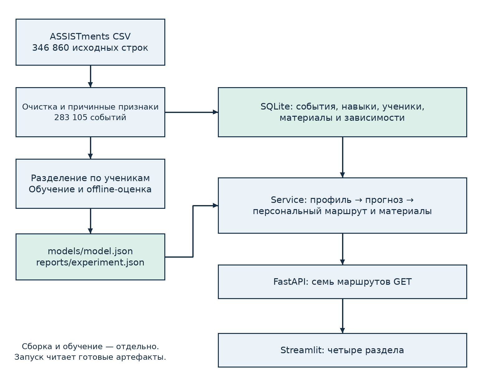

# EduPath ML

Веб-приложение для анализа истории математических ответов и составления индивидуального плана повторения. Курсовой проект по теме **«Разработка программного комплекса для оценки уровня знаний и формирования индивидуальных траекторий обучения»**.

EduPath работает с данными существующей образовательной системы. Преподаватель выбирает ученика, изучает результаты и прогноз следующего ответа, затем получает последовательность учебных шагов с материалами. Приложение не является полноценной LMS и **не проводит новое оцениваемое тестирование**.

## Возможности

- **Профиль ученика:** число ответов, доля правильных, темы с наблюдениями и достаточной историей, три основных сигнала затруднений.
- **Анализ знаний:** прошлые результаты и прогноз отдельно, количество наблюдений, подробности записей; одинаковые названия не объединяют разные ID.
- **План обучения:** до четырёх слабых тем с материалами плюс необходимая подготовка по графу. По шагам доступны цель, теория, разобранный пример, фиксированные задания и решения, источники и переходы.
- **Локальные отметки:** можно отметить просмотренный шаг в текущей сессии. Это не оценка освоения и не изменение прогноза.
- **API:** профили, траектории, материалы, справочник навыков, состояние приложения и сохранённый отчёт модели. Формат траектории проверяется сервером и клиентом, версия контракта — 2.

Библиотека содержит 23 записи по ID и 31 запись практических заданий, часть содержания повторяется у одноимённых ID. Граф содержит пять ручных зависимостей. Слабые темы без материала отображаются отдельно.

## Технологии

Python, SQLite, FastAPI, Uvicorn, Streamlit и requests. Вычислительное ядро использует стандартную библиотеку Python; логистическая модель реализована самостоятельно, без scikit-learn. NetworkX — необязательная дополнительная проверка графа. MLflow предусмотрен как отдельная необязательная регистрация готовых результатов, но его работа в текущей среде не подтверждена.

Для воспроизводимого окружения рекомендуется **Python 3.12**; фактически проверялся Python 3.12.3, FastAPI 0.162.2 и Streamlit 1.67.0. Основные зависимости перечислены в `requirements.txt`, дополнительные — в `requirements-optional.txt`. Виртуальное окружение с одного компьютера на другой не переносится.

## Данные ASSISTments

Использована исправленная collapsed-выгрузка **ASSISTments Skill Builder 2009–2010** с [официальной страницы](https://sites.google.com/site/assistmentsdata/home/2009-2010-assistment-data/skill-builder-data-2009-2010). В ней есть ученик, задание, ID навыка, порядок события и результат ответа.

| Показатель | Значение |
|---|---:|
| Исходные строки | 346 860 |
| Пригодные ответы после очистки | 283 105 |
| Ученики | 4163 |
| ID навыков | 149 |
| Правильные ответы | 186 322, или 65,81% |
| Исключённые строки без пригодного навыка | 63 755 |

Составные ID сохраняются целиком. История сортируется по ученику и `order_id`. Пропущенное название не заменяется выдуманной темой. Источник и особенности данных подробно описаны в [документации](docs/data_description.md).

**CSV и SQLite остаются локальными и не публикуются в Git.** Для обычного запуска нового клона нужна собственная готовая база либо официальный CSV для её восстановления. Модель и агрегированные отчёты входят в публикационный состав. Это означает, что одного клонирования без подготовки данных недостаточно. Инструкция — [data/README.md](data/README.md); условия и состав исключений — [уведомление о данных](docs/DATA_AND_THIRD_PARTY_NOTICE.md). Новая подготовка базы не требует переобучения.

## Модель и результаты

Модель прогнозирует вероятность **следующего правильного ответа по заданному навыку**, используя только предыдущую историю: число ответов, сглаженную общую успешность, число и успешность ответов по навыку, идентификатор навыка. Текущий результат, текущие подсказки/попытки и будущие ответы не используются.

Логистическая регрессия обучена SGD за 18 эпох. Разделение выполнено по ученикам с seed=42: train — 3330 учеников и 223 463 ответа; test — 833 других ученика и 59 642 ответа. Пересечение ID учеников — ноль. Прошлые ответы тестового ученика допустимы для прогноза последующих событий при неизменных коэффициентах.

| Метод | Accuracy | F1 | ROC-AUC | Log Loss ↓ | Brier ↓ |
|---|---:|---:|---:|---:|---:|
| Константа | 0,6562 | 0,7924 | 0,5000 | 0,6435 | 0,2256 |
| Историческое правило | 0,6862 | 0,7902 | 0,6670 | 0,6069 | 0,2088 |
| Logistic SGD | **0,7121** | **0,7981** | **0,7276** | **0,5653** | **0,1914** |

Результаты относятся к одному offline-разбиению. Они подтверждают улучшение над выбранными базовыми методами; точный уровень знаний и педагогическая эффективность маршрутов не измерены. Пороги и зависимости заданы вручную. Источники чисел — [эксперимент](reports/experiment.json), [CSV метрик](reports/model_metrics.csv), [описание эксперимента](docs/ml_experiment.md). Параметры модели сохранены в `models/model.json`.

## Структура проекта

```text
src/
  data/                 чтение и очистка истории
  ml/                   признаки, SGD, прогноз и метрики
  recommendation/       отбор и порядок учебных тем
  retrieval/            материалы, фиксированные уроки и поиск
  api/                  FastAPI, Service и контракт данных
ui/                     Streamlit и представление результатов
models/model.json       обученная модель
scripts/                подготовка базы, проверки и инструменты публикации
tests/                 тесты компонентов и контракта
reports/                сохранённые агрегированные отчёты и графики
docs/                  техническая документация и материалы к защите
data/                  инструкция; рабочие CSV/SQLite хранятся локально
.streamlit/config.toml  тема интерфейса; секретов не содержит
requirements.txt        основные зависимости
```

## Запуск на MacBook

Нужен доступ к приватному `lizagqq/edupath-ml`. После публикации репозитория выполните в Terminal. Если Homebrew уже установлен:

```bash
brew install python@3.12 git gh

gh auth login --hostname github.com --git-protocol https --web
gh repo clone lizagqq/edupath-ml
cd edupath-ml
python3.12 -m venv .venv
source .venv/bin/activate
python -m pip install -r requirements.txt
```

Если Homebrew отсутствует, установите Python 3.12 с python.org и GitHub CLI по официальной инструкции; установка Homebrew сама по себе для приложения не обязательна.

**Подготовьте данные одним из двух способов.** Проще всего перенести свою существующую `data/demo/edupath.db` с компьютера разработки в тот же путь клона. Например, скопировать файл в Downloads, затем из корня клона:

```bash
mkdir -p data/demo
cp -n "$HOME/Downloads/edupath.db" data/demo/edupath.db
```

Проверьте, что в Downloads действительно находится ваша рабочая база. `cp -n` не перезаписывает уже существующий целевой файл. Альтернатива: получить официальный CSV и выполнить `python scripts/prepare_database.py` по [инструкции](data/README.md). Ни один из этих способов не обучает модель.

В первом терминале, из корня клона:

```bash
.venv/bin/python -m uvicorn src.api.app:app --host 127.0.0.1 --port 8000
```

Во втором терминале перейдите в ту же папку:

```bash
EDUPATH_API=http://127.0.0.1:8000 .venv/bin/python -m streamlit run ui/app.py --server.address 127.0.0.1 --server.port 8501
```

Откройте **http://127.0.0.1:8501**. Страница API — http://127.0.0.1:8000/docs. При первом запуске не используйте `scripts/build_project.py`: он пересоздаёт базу и обучает модель.

## Запуск на Windows через WSL2

Используйте Ubuntu в WSL2; команды ниже выполняются в терминале Ubuntu, а не PowerShell. При необходимости WSL устанавливается через `wsl --install` в PowerShell, затем нужно завершить первичную настройку Ubuntu.

```bash
sudo apt update
sudo apt install python3 python3-venv python3-pip git gh
python3 --version
```

Нужен Python 3.11 или новее; ориентир проверенной версии — 3.12. Авторизуйтесь и клонируйте репозиторий:

```bash
gh auth login --hostname github.com --git-protocol https --web
gh repo clone lizagqq/edupath-ml
cd edupath-ml
python3 -m venv .venv
.venv/bin/python -m pip install -r requirements.txt
```

Поместите готовую базу в `data/demo/edupath.db` либо восстановите её из CSV по `data/README.md`. Запустите API и Streamlit двумя командами из раздела для MacBook. В браузере Windows откройте http://127.0.0.1:8501. Уже существующую рабочую папку `/home/liza/coursework-ml` пересоздавать или заменять клоном не нужно.

## Проверка и демонстрация

После запуска обоих процессов:

```bash
.venv/bin/python scripts/smoke_http.py
.venv/bin/python scripts/smoke_streamlit.py
```

Для проверки компонентов без обучения:

```bash
PYTHONPATH=tests .venv/bin/python -m unittest test_core.RecommendationTests test_core.ServiceTests test_api.APITests test_ui_presentation.PresentationTests test_learning_contract.LearningContractTests -v
```

В среде без разрешённых сокетов доступны:

```bash
.venv/bin/python scripts/smoke_asgi.py
.venv/bin/python scripts/smoke_streamlit.py --asgi
```

Последние две команды используют реальный FastAPI внутри процесса, но подменяют стандартный worker-пул прямым вызовом обработчика. AppTest проверяет элементы и переходы; это не браузерный визуальный тест. Ранее подтверждены 23 связанных теста и маршруты трёх учеников. Проверка свежей публикационной копии описана отдельно в [инструкции публикации](docs/GITHUB_PUBLISH.md). macOS как ОС в этой среде недоступна, а настоящий сетевой запуск и внешний вид последней версии ещё требуют проверки.

Демо: выберите `79021`. В профиле — 1061 ответ, 93 темы с наблюдениями, 56 тем минимум с тремя ответами. План: **повороты → отражение → круговые диаграммы → площадь круга → поверхность цилиндра**. Площадь круга добавлена как подготовка. Для `75169` — два шага, для `78970` — четыре. При 3–9 ответах сигнал предварительный. Личная отметка шага не меняет вероятность.

## Скриншоты и документация

Настоящих скриншотов в `reports/screenshots/` пока нет. Рисунок ниже — архитектурная схема, а не изображение браузерной проверки:



- [Объяснение проекта простыми словами](docs/PROJECT_EXPLAINED_SIMPLE.md).
- [Архитектура](docs/architecture.md), [рекомендатель](docs/recommender.md), [проверки](docs/testing.md).
- [Запуск и ручная проверка](docs/wsl_runbook.md), [изменения интерфейса](docs/ui_revision.md).
- [Подготовка GitHub и авторизация](docs/GITHUB_PUBLISH.md).

Ряд учебных Markdown-документов содержит исторические команды и сведения о локальных файлах. Текущее отсутствие CSV/SQLite в Git намеренно; сначала выполните подготовку данных. Word, исходные методички и внутренние архивы сохранены на компьютере разработки и не нужны для запуска.
