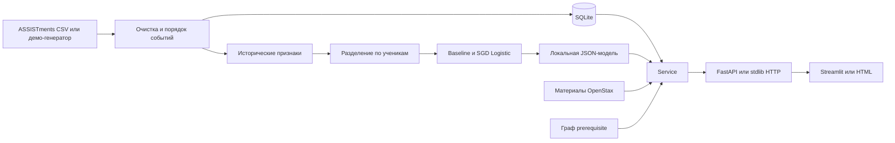
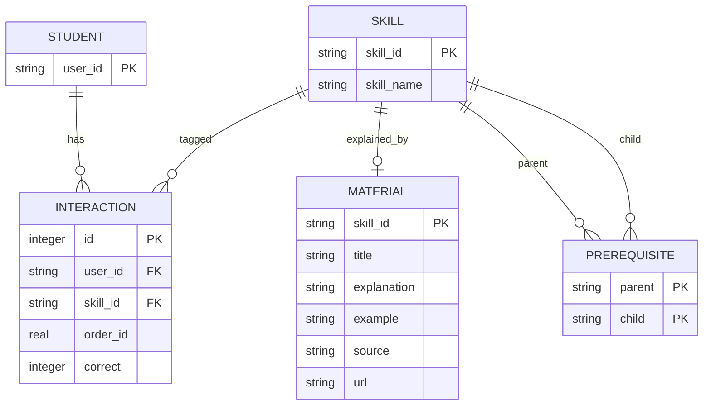

# Архитектура

SQLite хранит 283 105 реальных взаимодействий, 4163 ученика, 149 ID навыков, 23 записи материалов и пять рёбер предварительных знаний. JSON-модель загружается для прогноза по истории; Service объединяет профиль, материалы и personalized_plan. FastAPI и резервный stdlib-сервер используют один Service. Основной Streamlit получает профиль и структурированный план через API. Ответ траектории сохраняет прежние поля trajectory/trajectory_note и добавляет detected_difficulties, without_materials, reinforcement, focus_skill_ids, prerequisite_skill_ids и material_count. Внутри trajectory роль шага — focus или prerequisite. ui/presentation.py отвечает за названия, форматирование и риск; данные по разным ID не усредняются. Полная схема исполнения и передача состояния — в ../CODEX_HANDOFF.md.

## Учебный интерфейс 0.2.0 и контракт 2

Основной пользовательский слой теперь содержит три раздела: профиль, анализ знаний и план обучения. `ui/api_client.py` получает один ответ `/students/{id}/trajectory`, уже включающий профиль; данные ученика не кэшируются. `src/api/contracts.py` задаёт версию и проверяет структуру на стороне Service и после HTTP-десериализации в UI. Обязательные поля и вложенные уроки не восстанавливаются пустыми значениями при отсутствии — несовместимость явно диагностируется до отображения.

`src/retrieval/lessons.py` добавляет при чтении цели, теорию, разборы и фиксированные задания к существующим 23 записям. Таблицы и записи SQLite не изменены. `add_practice()` сохраняет прежние поля и обогащает ответ новыми. Отметки шагов находятся только в `session_state`, разделены по ученику и навыку; новые взаимодействия и прогнозы не создаются.

`/health` сообщает app_version=0.2.0 и trajectory_contract_version=2; ответ плана — contract_version=2. Отбор и граф не менялись. Главная интеграционная проверка подаёт JSON настоящего FastAPI в Streamlit AppTest внутри процесса; её транспорт и прямой вызов обработчиков подменяют сеть и стандартный пул потоков. Сетевая и визуальная проверка выполняется отдельно в Ubuntu.
