:::title
Министерство науки и высшего образования Российской Федерации
Федеральное государственное автономное образовательное учреждение высшего образования «Северо-Кавказский федеральный университет»
Институт перспективной инженерии
Департамент цифровых, робототехнических систем и электроники

КУРСОВАЯ РАБОТА
по дисциплине «Технологии программирования»

Разработка программного комплекса для оценки уровня знаний и формирования индивидуальных траекторий обучения
EduPath ML

Выполнил(а): [ФИО студента]
Направление подготовки: [код и наименование по учебным документам]
Профиль: [наименование профиля]
Курс: [курс], группа: [группа], форма обучения: [форма]
Руководитель: [должность, степень, ФИО]
Дата защиты: [дата]. Оценка: [оценка]. Подпись: __________
Ставрополь, 2026
:::endtitle

# ЛИСТ ЗАДАНИЯ

Институт перспективной инженерии. Департамент цифровых, робототехнических систем и электроники.

Направление подготовки: [заполнить]. Профиль: [заполнить]. Студент: [ФИО]. Дисциплина: «Технологии программирования».

1. Тема: «Разработка программного комплекса для оценки уровня знаний и формирования индивидуальных траекторий обучения».

2. Цель: разработать и исследовать прототип EduPath ML для анализа истории ответов, прогноза следующего ответа по навыку и формирования объяснимого порядка повторения тем.

3. Задачи: исследовать исходные данные; спроектировать приложение и БД; подготовить исторические признаки; сравнить модель с базовыми методами; реализовать персональную траекторию, поиск, API и интерфейс; проверить результаты и ограничения.

4. Вопросы теоретической части: образовательная аналитика, прогноз ответов, логистическая регрессия, проверка качества вероятностей, граф предварительных знаний. Вопросы практической части: модульная архитектура, SQLite, обработка событий, алгоритмы рекомендаций, пользовательский сценарий и тестирование.

5. Исходные данные: исправленный collapsed CSV ASSISTments Skill Builder 2009–2010; существующие исходные тексты и отчёты EduPath ML; открытые математические материалы OpenStax. Вариант преподавателя: [при наличии].

6. Рекомендуемые источники: методические указания, сборник лабораторных работ, официальное описание ASSISTments, статья о Knowledge Tracing Machines и документация выбранных технологий; подробный список приведён в конце работы.

7. Контрольные сроки: 25% — [дата]; 50% — [дата]; 75% — [дата]; 100% — [дата]. Срок защиты: [дата]. Дата выдачи: [дата].

Руководитель: [степень, звание, ФИО], подпись __________. Задание принял(а): [ФИО], подпись __________.

Содержательная часть листа подготовлена для согласования; реквизиты, сроки и подписи заполняются по утверждённому заданию.

# СОДЕРЖАНИЕ

:::toc

# ВВЕДЕНИЕ

Электронные журналы, системы дистанционного обучения и тренажёры заданий сохраняют сведения о том, как обучающиеся выполняют учебную работу. Помимо итоговой оценки, в них накапливаются ответы на отдельные задания, сведения о допущенных ошибках и последовательности изучения материала. Эти данные позволяют подробнее рассмотреть результаты ученика, если связать их с конкретными темами и умениями.

При традиционном оценивании такая детализация доступна не всегда. Одинаковая отметка за контрольную работу может скрывать разные затруднения: один ученик ошибается при вычислениях с дробями, другой — при решении уравнений. Итоговый балл удобен для общей характеристики результата, однако сам по себе не объясняет, что следует повторить и с чего начать. Чтобы выбрать дальнейшие задания, преподавателю приходится возвращаться к отдельным ответам и сопоставлять их между собой.

Индивидуальный подход предполагает, что содержание и порядок повторения учитывают подготовку обучающегося. Анализ образовательных данных может помочь в этой работе: выделить устойчивые ошибки, сопоставить результаты по темам и оценить вероятность успешного выполнения последующих заданий. Методы машинного обучения позволяют использовать накопленную историю ответов для такого прогноза. Практический смысл анализа состоит в том, чтобы на его основании предложить понятные дальнейшие действия [12].

Разрабатываемый программный комплекс EduPath ML представляет собой веб-приложение для работы с историей математических ответов из существующей образовательной системы. Преподаватель выбирает обучающегося, просматривает его результаты по навыкам, знакомится с прогнозом правильного выполнения следующего задания по каждой теме и получает индивидуальную последовательность повторения с учебными материалами. Приложение служит дополнительным аналитическим инструментом: исходные ответы уже получены в другой системе, а новое тестирование внутри комплекса не проводится.

Актуальность работы определяется потребностью связать подробные результаты учебной деятельности с выбором тем для повторения. Объект исследования — результаты учебной деятельности обучающихся, представленные историей ответов на математические задания. Предмет исследования — методы анализа этих результатов и формирования индивидуальной последовательности повторения с учётом выявленных затруднений и предварительных знаний.

Цель работы — разработать программный комплекс для оценки результатов обучающихся и формирования индивидуальных траекторий обучения на основе истории их ответов. Для её достижения необходимо изучить предметную область и подходы к анализу образовательных данных; сформулировать требования и выбрать технологии; подготовить данные и построить модель прогноза; разработать правила выбора тем и учебных материалов; реализовать веб-приложение и проверить полученные результаты. При этом проверяется предположение о том, что учёт предыдущих ответов позволяет прогнозировать результат точнее, чем постоянная оценка успешности, одинаковая для всех учеников и тем.

В работе используются анализ научной литературы, сравнительный анализ технологий, проектирование программной системы, методы машинного обучения и экспериментальная оценка качества. Практическая значимость заключается в возможности представить разрозненные ответы в виде профиля ученика и обоснованного маршрута повторения. Особенность решения состоит в согласовании прогноза затруднений, доступных материалов и зависимостей между темами в одном пользовательском сценарии.

Первая глава посвящена теоретическим основам оценки знаний, персонализации обучения и выбору технологий. Во второй главе описаны архитектура, алгоритмы и программная реализация комплекса. Третья глава содержит анализ результатов эксперимента, оценку выбранного подхода и направления дальнейшего развития.

# 1 ТЕОРЕТИЧЕСКАЯ ЧАСТЬ

## 1.1 Общие положения

### 1.1.1 Электронные образовательные системы и оценка результатов обучения

Электронная образовательная система объединяет средства предоставления учебных материалов, организации заданий и учёта результатов. В зависимости от назначения она может поддерживать целый учебный курс либо отдельный вид деятельности, например решение математических задач. Система управления обучением, часто обозначаемая сокращением LMS, обычно охватывает организацию курса, тогда как предметный тренажёр подробнее фиксирует работу с конкретными заданиями. Для анализа знаний особенно полезны те записи, в которых ответ соотнесён с проверяемым умением.

Такие системы могут собирать результат выполнения задания, число попыток, обращение к подсказкам, время работы и последовательность действий. Однако состав доступных сведений зависит от устройства платформы. Даже подробная история требует интерпретации: повторный ответ может свидетельствовать как о дополнительной тренировке, так и о затруднении, а использование подсказки меняет смысл успешно завершённого задания. Поэтому до построения выводов необходимо установить, что именно обозначают сохранённые показатели.

В образовательной аналитике (learning analytics) сведения об обучающихся рассматриваются как основание для понимания и улучшения учебного процесса. В статье Ф. Лонга и Дж. Сименса внимание обращается на разрыв между накоплением данных и своевременным использованием их при принятии решений [12]. Для оценки знаний это означает переход от хранения отметок к анализу того, в каких действиях ученик успешен и где ему требуется поддержка. Полезность такого анализа определяется не количеством показателей, а тем, помогают ли они выбрать обоснованное педагогическое действие.

Итоговая оценка и анализ отдельных навыков решают разные задачи. Первая даёт обобщённую характеристику работы, второй раскрывает её состав. Например, ошибка в задаче на площадь поверхности тела может быть связана с незнанием формулы, вычислительной ошибкой или недостаточным пониманием площади основания. Одного неверного ответа недостаточно, чтобы уверенно выбрать объяснение. Последовательность попыток и результаты по связанным темам позволяют сузить круг предположений, хотя не заменяют беседы с учеником и содержательного разбора решения.

По этой причине наблюдаемую успешность следует рассматривать вместе с объёмом и условиями наблюдений. Два правильных ответа из двух и двадцать из двадцати дают одинаковую долю успеха, но имеют разную доказательную силу. Кроме того, результаты зависят от трудности предложенных заданий. Профиль знаний становится содержательнее, когда общая оценка дополняется отдельными показателями по темам, числом ответов и понятным объяснением того, как получен вывод.

### 1.1.2 Персонализация обучения и индивидуальная траектория

Потребность в индивидуальном подходе возникает из различий в подготовке, темпе работы и учебных целях. Повторение всего раздела полезно не каждому: ученик может уверенно выполнять большую часть действий и испытывать трудности только с одним из них. В такой ситуации важен выбор подходящего содержания, а не просто увеличение числа заданий. Персонализированное обучение предполагает учёт особенностей конкретного обучающегося при определении содержания и организации учебной работы.

Адаптивное обучение делает акцент на изменении учебных условий в ответ на сведения о текущих результатах. В исследовании Х. Пэна, Ш. Ма и Дж. М. Спектора персонализация и адаптация рассматриваются как связанные подходы: индивидуальные характеристики и достижения используются для корректировки учебных решений [13]. Их различие важно для проектирования программы. Индивидуальный план может быть подготовлен по уже накопленным данным, тогда как непрерывная адаптация требует получения новых результатов и пересмотра плана по мере обучения.

Индивидуальная образовательная траектория в широком смысле охватывает цели, содержание, темп и последовательность учебной деятельности. В системе поддержки повторения она может быть представлена более узко — как обоснованный порядок тем и материалов для конкретного ученика. Такая последовательность должна объяснять, почему включена каждая тема, и оставаться связанной с учебной целью. Перечень всех доступных ресурсов ещё не образует индивидуальную траекторию: для этого необходим отбор, основанный на результатах обучающегося.

Связующим звеном между оцениванием и персонализацией служит интерпретация затруднения. Сначала результаты позволяют предположить, какое умение требует внимания; затем выбираются подходящие материал и место темы в последовательности повторения. Если этот переход не определён, даже точный прогноз остаётся лишь числом в отчёте. Вместе с тем автоматическая рекомендация должна быть понятна преподавателю: он располагает сведениями о целях занятия и состоянии ученика, которых может не быть в выгрузке данных.

### 1.1.3 Прогнозирование ответов и роль предварительных знаний

Машинное обучение позволяет находить зависимости между прежними результатами и последующими ответами. В отличие от простой сводки ошибок, прогноз отвечает на вопрос о вероятном результате ещё не выполненного задания. Для этого используются сведения, известные до ответа: предыдущая успешность, объём практики, принадлежность задания к определённой теме. Прогноз можно рассматривать как дополнительный ориентир для выбора повторения, если ясно указано, к какому событию он относится.

Направление исследований, посвящённое отслеживанию знаний обучающегося (knowledge tracing), изучает изменение оценок его подготовки по последовательности взаимодействий с учебной системой. В работе А. Корбетта и Дж. Андерсона оценка усвоения правил программирования связывалась с выбором индивидуальной последовательности упражнений [14]. Существенна сама постановка вопроса: результаты отдельного действия рассматриваются в контексте предшествующей работы, а полученная оценка используется при принятии следующего учебного решения.

Внутри этого направления существуют разные способы описания ученика. Одни модели представляют знания как скрытое, непосредственно не наблюдаемое состояние; другие прогнозируют ответы по признакам прошлой деятельности. Дж.-Ж. Ви и Х. Касима рассматривают факторные модели, позволяющие объединять сведения об учащихся, заданиях и накопленной практике [4]. Для прикладной системы выбор между подходами зависит от доступных данных и требуемой интерпретации. Вероятность правильного ответа удобна для сравнения ожидаемых результатов, но её нельзя без дополнительного обоснования считать вероятностью полного освоения темы.

При переходе от прогноза к маршруту необходимо учитывать содержательные связи учебного материала. Если затруднение относится к делению дробей, может потребоваться повторение умножения и обратных чисел. В задачах на поверхность цилиндра используется площадь круга. Выбор только тем с самыми низкими результатами способен пропустить такую подготовку и привести к повторению сложного действия без восстановления его основы.

Зависимости помогают различать срочность и порядок изучения. Тема может требовать первоочередного внимания по результатам ученика, но занимать более позднее место в маршруте, поскольку перед ней необходимо повторить другое понятие. Теоретическая основа подобного решения состоит в согласовании трёх составляющих: сведений об ученике, структуры предмета и доступного учебного содержания. Оценка результатов приобретает практическое значение именно тогда, когда эти составляющие позволяют обосновать дальнейшую работу.

## 1.2 Обзор технологий программирования

### 1.2.1 Архитектурные подходы и языки разработки

Система анализа образовательных данных объединяет несколько видов работы: получение исходных записей, их обработку, расчёт показателей и представление результата. Разделение этих задач на модули позволяет изменять одну часть без полной переработки остальных. Например, замена способа хранения не должна требовать изменения смысла прогноза, а обновление интерфейса — повторной реализации правил выбора тем. Значение модульной архитектуры состоит в явном определении ответственности компонентов и данных, которыми они обмениваются.

Модульность не требует распределения программы по множеству независимых сервисов. Для небольшого приложения достаточно одного проекта с отделёнными вычислительным ядром, хранилищем и пользовательским слоем. Распределённая архитектура становится полезной, когда части системы имеют разную нагрузку или разрабатываются отдельными командами. При этом она усложняет развёртывание и проверку обмена данными. Для учебного прототипа такие издержки оправданы только при наличии конкретной задачи, которую трудно решить в более простой структуре.

Язык программирования выбирается с учётом преобладающей работы. Python удобен для обработки таблиц, машинного обучения и объединения вычислений с веб-интерфейсом. R предоставляет развитые средства статистического анализа и подходит для исследовательских расчётов. Java и C# позволяют строить серверные приложения с выраженной системой типов, но для сравнительно небольшого аналитического проекта могут потребовать большего объёма связующего кода. JavaScript и TypeScript широко применяются при создании браузерного интерфейса; их использование может быть оправдано, когда требуется сложное взаимодействие пользователя со страницей. Выбор языка поэтому следует связывать с назначением системы, а не с предположением об универсальном преимуществе одной технологии.

### 1.2.2 Хранение и подготовка образовательных данных

Для передачи выгрузки удобен табличный файл, например CSV: его можно получить из разных систем и прочитать без специализированного сервера. Однако по мере накопления связанных сущностей — учеников, навыков, ответов и материалов — файлового представления становится недостаточно. Приходится контролировать соответствие идентификаторов, избегать повторения справочных сведений и быстро выбирать историю одного пользователя. Эти задачи естественно решаются средствами реляционной базы данных.

Серверные системы управления базами данных, например PostgreSQL, подходят для совместного доступа, большого числа соединений и управляемой многопользовательской записи. Встраиваемая SQLite хранит базу в локальном файле и не требует отдельного серверного процесса. Её проще включить в небольшой проект и передать вместе с готовым приложением. В документации SQLite это различие описывается как выбор между локальным хранением приложения и общим серверным хранилищем [17]. Поэтому оценивать технологии следует по режиму использования, а не только по числу записей.

Документные и графовые хранилища полезны для данных с иной организацией связей, однако их применение не обязательно для каждой аналитической системы. Небольшой граф зависимостей можно хранить как таблицу пар тем, а обход выполнять в программе. Отдельная графовая база приобретает смысл при большом объёме связей и сложных запросах по ним. В любом варианте качество последующего анализа зависит от предварительной проверки данных: ошибку в идентификации навыка нельзя исправить выбором более сложного хранилища.

### 1.2.3 Методы анализа и машинного обучения

Первый уровень анализа составляют описательные показатели: число ответов, доля успеха и распределение ошибок по темам. Они дают основу для понимания данных и нужны даже при наличии обучаемой модели. Более сложный метод имеет смысл применять, если он решает задачу, с которой эти показатели справляются недостаточно хорошо, и его преимущество можно проверить на отложенных данных.

Для прогноза бинарного результата подходят логистическая регрессия, методы на основе деревьев решений и последовательные модели. Логистическая регрессия связывает признаки с вероятностью ответа и позволяет исследовать влияние их сочетания. Её возможности ограничены выбранным представлением признаков. Ансамбли деревьев способны учитывать более сложные зависимости, но также требуют настройки и оценки вероятностей. Нейронные модели последовательностей могут использовать порядок множества событий, однако усложняют обучение и интерпретацию. Без сравнительного эксперимента нельзя заранее установить, какой подход окажется полезнее на конкретной выгрузке.

Отдельный вопрос — организация проверки. Если обучать модель на сведениях, которые в момент прогноза ещё неизвестны, результат не будет отражать реальный сценарий применения. Поэтому признаки формируются только по прошлым действиям. Разделение данных должно соответствовать исследовательскому вопросу: для оценки работы с новыми учениками их истории отделяются от историй обучающей группы. Прежние ответы проверочного ученика при этом могут использоваться для прогноза его следующих действий, если параметры модели остаются неизменными.

### 1.2.4 Рекомендации, зависимости тем и поиск материалов

Рекомендательные системы различаются по тому, на каком основании они выбирают ресурс. Совместная фильтрация использует сходство поведения пользователей: материалы, оказавшиеся востребованными у одних учащихся, предлагаются другим с похожей историей. Такой подход нуждается в достаточном числе взаимодействий и испытывает трудности при появлении нового ресурса или ученика. Содержательный подход сопоставляет описание материала с характеристиками пользователя и меньше зависит от оценок других учащихся, но требует качественных метаданных.

Рекомендации на основе знаний опираются на явно заданные отношения между потребностями ученика и учебным содержанием. В обзоре Дж. Таруса, Ч. Ню и Г. Мустафы рассмотрено использование онтологий, то есть формализованных описаний понятий и связей, для представления учащихся и ресурсов [15]. Для небольшой предметной области можно использовать более ограниченную систему правил без полной онтологии. Её достоинство — возможность объяснить выбор; ограничение — необходимость вручную поддерживать правила и проверять их содержательный смысл.

В образовательной задаче полезно сочетать прогноз с такими правилами. Модель указывает на вероятное затруднение, а предметные ограничения определяют допустимый порядок повторения. Зависимости представляются ориентированным графом: вершины обозначают темы, стрелка указывает переход от предварительной темы к зависимой. Если граф не содержит циклов, его можно упорядочить так, чтобы предварительные темы располагались раньше. Этот порядок не единственен; среди допустимых вариантов требуется учитывать результаты ученика и объём предлагаемой работы.

Поиск ресурса и выбор учебной темы при этом остаются разными операциями. Поиск по словам подходит для небольшой библиотеки с известными названиями и подготовленными объяснениями. Поиск по векторным представлениям текста может находить близкие по смыслу формулировки без совпадения слов, но требует дополнительной модели и отдельной проверки соответствия. Генерация ответа по найденным материалам добавляет ещё один этап, качество которого также нужно оценивать. При точной связи темы с ресурсом надёжнее использовать эту связь непосредственно, оставив свободный поиск для самостоятельных запросов.

Исследования образовательных рекомендательных систем показывают и важность выбора критерия качества. В систематическом обзоре Ф. Лейте да Силвы и соавторов отмечено, что точность рекомендаций изучалась чаще, чем их педагогическая результативность [16]. Для разработки это означает необходимость разделять проверку работы алгоритма и проверку того, улучшает ли предложенная последовательность обучение. Первая доступна по данным и формальным правилам; вторая требует исследования с обучающимися.

### 1.2.5 Технологии веб-приложений

Веб-приложение позволяет представить результаты анализа в браузере, не требуя от пользователя работы с файлами и командами. Серверная часть получает запрос, обращается к данным и возвращает результат; интерфейс организует выбор ученика и отображение профиля. Согласованный программный интерфейс обмена данными (API) отделяет эти обязанности и позволяет проверять вычисления независимо от оформления страницы.

Django предлагает развитую основу для приложения с пользователями, формами и административной частью. Flask даёт более компактный каркас и оставляет значительную часть решений разработчику. FastAPI ориентирован на описание API, проверку входных параметров и автоматическое документирование запросов [18]. При выборе важно определить, нужна ли системе полноценная организация учебного процесса или преимущественно доступ к аналитическим результатам.

Пользовательский интерфейс можно создать как отдельное браузерное приложение либо средствами аналитической среды, такой как Streamlit. Первый вариант предоставляет больше свободы в оформлении и взаимодействии, но требует самостоятельной разработки клиентской части. Второй позволяет средствами Python связать элементы выбора, таблицы и графики с расчётами [19]. Для исследовательского приложения это сокращает путь от данных к обозримому результату, хотя ограничивает гибкость по сравнению со специально спроектированным интерфейсом.

Рассмотренные технологии образуют несколько возможных сочетаний. Их обоснованный выбор должен учитывать объём данных, состав пользователей, характер вычислений и способ проверки результата. Для приложения, которое анализирует готовую историю и объясняет выбор тем, особое значение имеют разделение ответственности модулей и возможность проследить происхождение каждого показателя.

## 1.3 Анализ выбранных технологий

### 1.3.1 Язык программирования и локальное хранение

Для EduPath ML выбран Python, поскольку основная работа связана с обработкой образовательных данных, вычислением прогнозов и представлением аналитических результатов. Использование одного языка упрощает согласование этих частей: данные не требуется многократно преобразовывать при передаче между разными программными средами. Стандартная библиотека предоставляет средства чтения таблиц, работы с SQLite и сохранения модели, а веб-инструменты позволяют использовать те же вычисления в приложении.

По сравнению с R такой выбор удобнее для соединения исследовательской обработки с серверными функциями в рамках одного проекта. Java и C# также пригодны для этой задачи, однако их преимущества для крупных корпоративных приложений не являются определяющими при разработке локального прототипа. Python уступает компилируемым языкам в скорости многих вычислений, поэтому его применение предполагает разумный выбор алгоритмов и объёма промежуточных данных. В данном случае достаточно сравнительно компактной модели и обработки готовой истории.

SQLite выбрана для хранения учеников, математических навыков, ответов, материалов и зависимостей между темами. Эти сведения имеют устойчивую табличную структуру и связываются идентификаторами. Реляционная организация позволяет отделить историю действий от справочников и обращаться к нужным данным запросами, не просматривая заново исходную выгрузку. При локальной демонстрации отсутствие отдельного сервера БД упрощает установку и передачу проекта [17].

PostgreSQL была бы разумной альтернативой при разработке общего сервиса с большим числом пользователей и частыми одновременными изменениями данных. В рассматриваемом сценарии преобладает чтение заранее подготовленной истории. Поэтому усложнение инфраструктуры не даёт необходимого для поставленной задачи преимущества. При этом выбор SQLite не определяет всю архитектуру: вычисления отделены от хранения, что оставляет возможность пересмотреть его при изменении требований.

### 1.3.2 Серверная часть и пользовательский интерфейс

Серверная часть реализована с помощью FastAPI. Её назначение — предоставить доступ к профилю, прогнозам, материалам и маршруту через согласованные запросы. Для такой задачи полезны проверка параметров и автоматическое описание API: они помогают обнаруживать неправильные обращения и проверять контракт между сервером и интерфейсом [18]. Под контрактом здесь понимается установленный состав входных параметров, ответов и сообщений об ошибках.

В сравнении с Django выбранный инструмент не предполагает использования широкого набора средств управления сайтом, которые в аналитическом приложении пока не нужны. Flask также позволил бы создать необходимые запросы, но часть описания и проверки пришлось бы организовывать отдельно. Выбор FastAPI связан с удобством разработки API, а не с заявлением о доказанном превосходстве по производительности: отдельного сравнения веб-средств в работе не проводилось.

Streamlit используется для интерфейса, в котором преобладают выбор ученика, просмотр таблиц, пояснений и карточек материалов. Для этого не требуется разрабатывать самостоятельную клиентскую программу: элементы страницы задаются средствами Python и связываются с полученными данными [19]. Такой подход позволяет сосредоточиться на том, насколько понятно представлены результаты анализа.

Отдельный интерфейс на JavaScript или TypeScript дал бы больше возможностей для сложной навигации и индивидуального оформления. Однако в рамках поставленной задачи эти возможности потребовали бы дополнительной работы, не меняя содержания прогноза и рекомендаций. Streamlit соответствует роли аналитического инструмента; при превращении проекта в полноценный образовательный портал требования к интерфейсу пришлось бы рассмотреть заново. Разделение серверной части и представления позволяет принять такое решение независимо от вычислительной модели.

### 1.3.3 Логистическая модель и оценка прогноза

История ответов позволяет получить как описательные показатели, так и признаки для прогноза. Простейшая характеристика результата по навыку — доля правильных ответов, приведённая в формуле (1).

$$ a = c / n, при n > 0. (1)

где c — число правильных ответов по рассматриваемому навыку; n — число ответов по нему. Этот показатель понятен пользователю, но описывает только состоявшиеся события. Для оценки последующего ответа нужно учитывать и различия между навыками, и более общую историю ученика.

В проекте для этого применяется логистическая регрессия. Она объединяет сведения о предыдущей практике и успешности, после чего преобразует полученную оценку в вероятность. Общий вид преобразования представлен формулой (2).

$$ p = 1 / (1 + exp(−z)); z = w₀ + Σ wⱼxⱼ + wₛ. (2)

где p — вероятность правильного ответа; z — взвешенная сумма признаков; w₀ — свободный член; xⱼ — исторические признаки; wⱼ — их коэффициенты; wₛ — отдельный коэффициент навыка. Такое представление позволяет различать общую результативность ученика и его практику в конкретной теме, не вводя сложную модель внутреннего состояния знаний.

При малом числе наблюдений обычная доля успеха резко меняется после каждого ответа. Поэтому в признаках используется сглаженная оценка по формуле (3).

$$ r = (c + 1) / (n + 2). (3)

где c и n относятся к ответам, известным до прогнозируемого события. При отсутствии истории оценка равна 0,5, а с накоплением ответов приближается к наблюдаемой частоте. Это способ аккуратнее представить небольшую историю в расчёте; само по себе сглаживание не делает вывод об освоении темы достоверным.

Коэффициенты логистической модели подбираются методом стохастического градиентного спуска, обозначаемым SGD. Он последовательно корректирует параметры по ошибкам на обучающих примерах и подходит для обработки большого числа однотипных записей. Его преимущества для проекта — сравнительно простая реализация и возможность сохранять небольшой набор параметров. Настройка обучения влияет на результат, поэтому выбранную модель необходимо сопоставлять с базовыми методами на данных, не использованных для подбора коэффициентов.

Альтернативой могли бы быть ансамбли деревьев или модели отслеживания скрытого состояния знаний. Первые позволяют описывать нелинейные сочетания признаков, вторые подробнее формализуют предположения об обучении. Для данной работы логистическая модель представляет разумный исходный выбор: она отвечает на поставленный вопрос о вероятности ответа и позволяет проследить связь результата с историей. Собственная реализация SGD, используемая в проекте, не является реализацией байесовского отслеживания знаний или факторизационной машины. Эти подходы рассматриваются как исследовательский контекст [4; 14].

Качество оценивается по нескольким показателям. Доля верных классификаций, точность, полнота и F1 характеризуют распознавание правильных и ошибочных ответов при выбранном пороге. Площадь под ROC-кривой, обозначаемая ROC-AUC, показывает, насколько хорошо модель ранжирует эти два класса. Для рекомендаций особенно важны сами вероятности, поэтому дополнительно рассматриваются логарифмическая ошибка и оценка Брайера [5].

$$ LogLoss = −(1/N) Σ [yᵢ ln(pᵢ) + (1−yᵢ) ln(1−pᵢ)]. (4)

$$ Brier = (1/N) Σ (yᵢ−pᵢ)². (5)

где N — число проверочных ответов; yᵢ — фактический результат, равный 0 или 1; pᵢ — вероятность, рассчитанная до ответа. Логарифмическая ошибка сильнее штрафует уверенные неверные прогнозы, а оценка Брайера характеризует среднее квадратичное отклонение от результата. Их совместное рассмотрение помогает избежать выбора модели только по доле правильных классификаций. Соответствие заявленных вероятностей наблюдаемым частотам требует также отдельного анализа калибровки.

### 1.3.4 Правила формирования маршрута и работа с материалами

Для формирования траектории выбран подход, сочетающий прогноз с явными правилами приоритизации. В используемых данных есть история решений, но нет подтверждённой оценки полезности каждого предлагаемого материала. Это ограничивает обоснованность совместной фильтрации: похожие ответы ещё не показывают, какое чтение помогло похожему ученику. Явные правила позволяют опираться на доступные сведения и объяснять, как из них получена рекомендация.

Актуальный алгоритм выбирает до четырёх выявленных слабых тем, для которых подготовлены материалы, и добавляет необходимые предварительные знания. Затруднения без материалов сохраняются отдельно, поэтому ограниченность библиотеки не скрывает их от пользователя. Числовой приоритет определяет, какая тема требует большего внимания, а граф задаёт допустимый порядок. Например, площадь круга может быть включена перед поверхностью цилиндра, даже если прогноз по цилиндру ниже. В отличие от полного онтологического описания предмета [15], здесь используется небольшой вручную заданный граф, достаточный для демонстрации данного принципа.

Лексический поиск выбран для обращения к подготовленным объяснениям по словам запроса. При небольшой библиотеке он не требует отдельной языковой модели и сохраняет понятную связь результата с текстом материала. Его ограничение состоит в зависимости от формулировки: близкий по смыслу запрос без общих слов может быть обработан хуже. Векторный поиск мог бы расширить такие возможности, но потребовал бы дополнительной оценки. Для шага маршрута используется более определённое соответствие — привязка материала к идентификатору навыка.

Учебные объяснения подготовлены заранее; система не генерирует новые тексты. Это позволяет сосредоточить проверку на соответствии темы, материала и причины рекомендации. Выбранное сочетание технологий отвечает задаче аналитического дополнения к существующей образовательной системе: модель оценивает ожидаемый результат, правила связывают его с порядком повторения, а веб-интерфейс делает это решение доступным пользователю.

## 1.4 Постановка задачи

### 1.4.1 Назначение комплекса и основные процессы

Разрабатываемый программный комплекс предназначен для анализа истории математических ответов и подготовки индивидуальной последовательности повторения. Его основной пользователь — преподаватель, которому необходимо сопоставить результаты ученика по навыкам и выбрать темы для дальнейшей работы. Исследователь может использовать те же представления для проверки поведения модели и рекомендаций. Приложение работает с данными существующей образовательной системы и не берёт на себя организацию учебного курса.

Первый основной процесс выполняется до пользовательской работы. Исходные записи проверяются и упорядочиваются, по предшествующим ответам формируются исторические признаки. Затем данные разделяются по обучающимся на обучающую и проверочную части, модель обучается и сопоставляется с базовыми методами. Очищенные события, параметры модели и результаты эксперимента сохраняются для дальнейшего использования. Подготовка должна быть воспроизводимой, а текущий и будущие ответы не должны попадать в признаки своего прогноза.

Второй процесс связан с использованием готового приложения. Пользователь открывает его в браузере, выбирает обучающегося и изучает профиль: число ответов, результаты по навыкам и вероятности правильного выполнения следующих заданий. На этой основе приложение показывает предполагаемые затруднения и маршрут повторения с пояснениями и учебными материалами. Оно использует сохранённую модель; обращение к профилю не запускает её обучение.

### 1.4.2 Входные данные и функциональные требования

Основной набор данных — ASSISTments Skill Builder 2009–2010, содержащий математические ответы обучающихся. Используется исправленная выгрузка, в которой несколько меток навыков одного ответа могут быть объединены в составной идентификатор [3]. После подготовки в проекте используются 283 105 ответов 4163 учеников и 149 идентификаторов навыков. Эти сведения определяют масштаб задачи; правила очистки и особенности исходных полей подробно рассматриваются во второй главе.

Входные данные включают идентификаторы ученика и навыка, порядок события и бинарный результат ответа. Дополнительно используются исходные названия навыков, подготовленные учебные объяснения со ссылками и зависимости между темами. Выход подготовительного процесса — очищенная история, сохранённая модель и отчёт о качестве. Выход пользовательского процесса — профиль ученика и объяснённая последовательность повторения. Историческая успешность и прогноз должны быть различимы, поскольку они характеризуют разные стороны результата.

Основные функциональные требования приведены в таблице 1.1. Их формулировка связывает назначение системы с тем, что пользователь или разработчик может проверить в готовом приложении.

Таблица 1.1 — Функциональные требования к программному комплексу

| Функция | Требуемый результат |
|---|---|
| Подготовка истории | Проверенные события с сохранённым порядком ответов |
| Построение и оценка модели | Прогноз по прошлым данным и сравнение с базовыми методами |
| Просмотр профиля | Результаты по навыкам, число наблюдений и вероятности ответов |
| Выявление затруднений | Отдельное представление слабых тем и недостатка данных |
| Формирование траектории | До четырёх основных тем с материалами и необходимая подготовка |
| Доступ к материалам | Объяснения, примеры, источники и поиск по библиотеке |
| Обработка особых ситуаций | Пояснение пустого маршрута и затруднений без материалов |

Материалы должны соответствовать точным идентификаторам навыков, а рекомендуемый порядок — учитывать сохранённые зависимости. При небольшом числе ответов пользователю необходимо сообщать об ограниченности основания вывода. Если подходящих тем с материалами нет, ожидается пустой результат с объяснением, а не автоматически предложенный общий каталог. Передача данных между серверной частью и интерфейсом должна обеспечивать одинаковое содержание профиля и маршрута.

### 1.4.3 Условия использования и границы задачи

Для работы необходимы персональный компьютер, интерпретатор Python, зависимости веб-приложения и браузер. В качестве рабочего ориентира рассматривается компьютер с 8 ГБ оперативной памяти; это условие разработки, а не установленный испытаниями минимальный объём. Специализированный графический ускоритель не требуется. Программное окружение должно поддерживать используемые версии FastAPI и Streamlit; для воспроизведения полного подготовительного процесса применяется Python 3.11 или новее. Готовое приложение запускается из существующего виртуального окружения с локальными файлами данных и модели.

Система рассчитана на анализ подготовленной выгрузки. В неё не входят регистрация обучающихся, ведение учебных курсов и проведение нового оцениваемого тестирования. Короткие вопросы в материалах предназначены для самостоятельной сверки: ответы на них не сохраняются и не изменяют профиль. Представленные прогнозы и последовательность тем помогают принять решение о повторении, но не заменяют содержательной оценки преподавателя. В этих границах задача состоит в создании согласованного пути от истории ответов к понятному и обоснованному предложению дальнейшей учебной работы.

# 2 ТЕХНОЛОГИЯ РАЗРАБОТКИ ПРИЛОЖЕНИЯ

## 2.1 Алгоритм решения

### 2.1.1 Общая последовательность и разделение режимов

Программа имеет два режима жизненного цикла: подготовку артефактов и использование готовой системы. На подготовительном этапе читается исходный CSV, выполняются очистка и анализ, строятся признаки, выделяются обучающие и проверочные ученики, обучается модель и сохраняются результаты. На этапе использования Service читает SQLite и модель, рассчитывает профиль выбранного ученика и формирует маршрут. Вызов траектории не запускает обучение.

Архитектурная схема на рисунке 2.1 показывает потоки между этапами и компонентами. Отдельная ветвь с JSON позволяет изменять материалы и граф без изменения коэффициентов. SQLite объединяет события, справочники и текущую версию базы знаний. Веб-слой обращается к единому Service, благодаря чему основной и резервный серверы используют одну вычислительную логику.

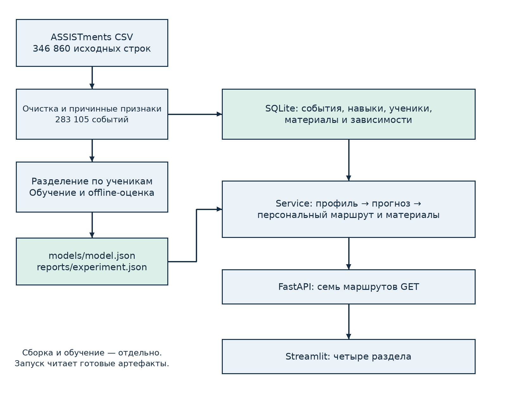

Общий алгоритм подготовки представлен на рисунке 2.2. Его существенный инвариант — признаки фиксируются до обновления счётчиков текущим correct. В блоке обучения используется только train, а test участвует в последующем расчёте метрик. Групповое разделение можно выполнить после подготовки признаков, поскольку состояние хранится отдельно для каждого ученика и не объединяет целевые ответы разных пользователей.

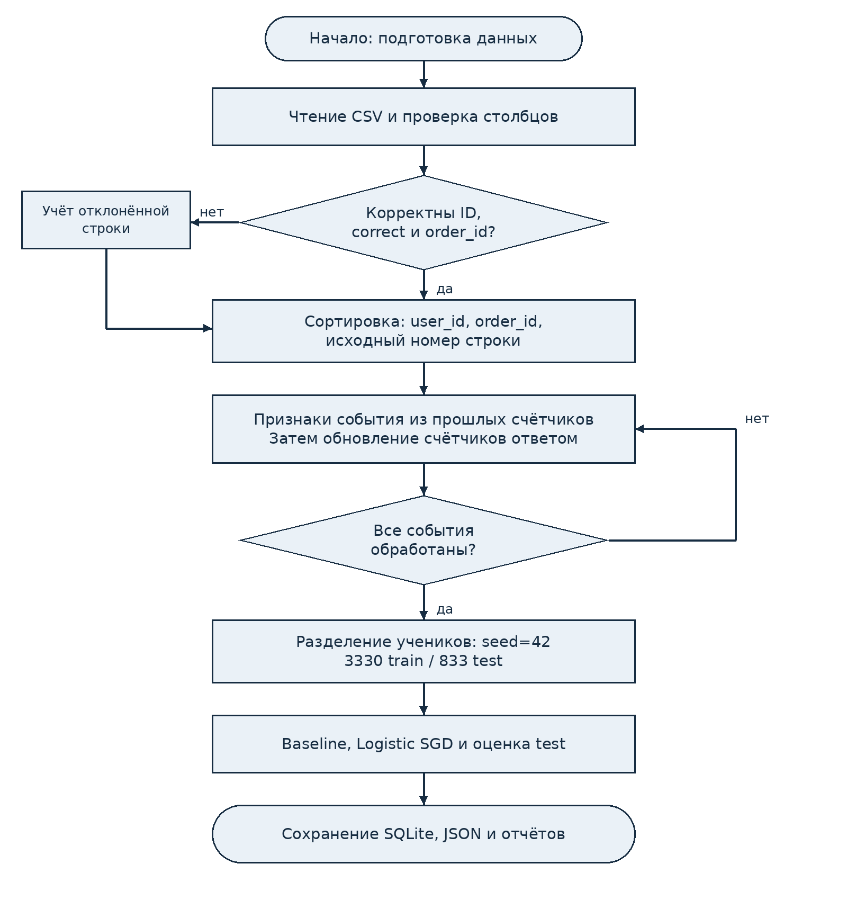

### 2.1.2 Чтение и очистка исходных событий

Функция load_assistments() использует csv.DictReader с кодировкой utf-8-sig. Ошибочные байты текста заменяются при декодировании; аудит исходника выявил пять таких байтов в answer_text, которое не участвует в модели. Проверяются обязательные столбцы user_id и correct, наличие идентификации навыка и order_id. Отсутствие порядка событий приводит к исключению, поскольку причинный сценарий без него не определён.

Для каждой строки нормализуются пробелы и маркеры пустого значения: пустая строка, na, nan, none и null. correct преобразуется в число и допускается только как 0 или 1; order_id должен быть конечным числом. Пользователь и навык должны быть непустыми. При отсутствии skill_id загрузчик допускает использование доступной метки skill_name; в фактическом файле итоговый аудит показывает 149 сохранённых ID и исключение 63 755 строк без пригодной идентификации навыка.

Исходный номер строки сохраняется в _source_row как дополнительное правило разрешения совпадений порядка. Сортировка выполняется по user_id, order_id и _source_row. В проверенном файле повторов пары user_id–order_id не выявлено. Наличие 4779 повторных пар user_id–problem_id не приводит к удалению событий: повторное решение задачи не равно дублированию одной записи. Исключение таких строк без дополнительного основания изменило бы историю обучения.

Составные ID, например 2_37_70, сохраняются строками целиком. Официальное описание collapsed-версии указывает, что несколько навыков одного student–problem объединяются в одну такую запись [3]. Разбиение составного ID на части создало бы другую постановку задачи и потребовало бы иной схемы признаков и проверки.

### 2.1.3 Причинные признаки

features() поддерживает два словаря состояния: total[u]=[n,c] для ученика и skill[u,s]=[nₛ,cₛ] для пары ученик–навык. Перед текущим событием извлекаются прошлые счётчики, записываются признаки, затем correct увеличивает соответствующие суммы. Так запрещённое знание текущего ответа не попадает в собственный прогноз.

Таблица 2.1 фиксирует соответствие математических величин и полей реализации. Преобразование log1p ограничивает масштаб больших счётчиков; делители 4 и 3 заданы в коде, а не подбирались по отдельной валидационной выборке.

Таблица 2.1 — Числовые признаки и доступность информации

| Поле | Значение перед текущим ответом |
|---|---|
| prior_count | Число прежних ответов ученика n |
| prior_success | (c+1)/(n+2) по всей прошлой истории |
| prior_skill_count | Число прежних ответов по навыку nₛ |
| prior_skill_success | (cₛ+1)/(nₛ+2) по навыку |
| log_prior_count | log(1+n)/4 при построении вектора |
| log_prior_skill_count | log(1+nₛ)/3 при построении вектора |

Например, перед первым ответом оба счётчика равны нулю, обе сглаженные доли — 0,5. После первого правильного ответа перед следующим событием общий счётчик становится 1, а общий успех — 2/3. Для нового навыка его локальные признаки остаются 0 и 0,5. Этот расчёт иллюстрирует код и не является отдельным экспериментом на синтетических данных.

При построении профиля текущая накопленная история полностью считается прошлой относительно следующего, ещё не наблюдавшегося ответа. Поэтому Service использует итоговые счётчики, а не признаки последней строки из обучающего CSV. Текущие attempt_count и hint_count не используются: они становятся известны в ходе решения и могли бы раскрывать целевой результат.

### 2.1.4 Обучение, сохранение и применение модели

group_split() сортирует уникальные строковые user_id, перемешивает их генератором с seed=42 и относит round(0,2×4163)=833 ученика в test. Остальные 3330 входят в train. Число строк зависит от длины историй: 223 463 обучающих и 59 642 проверочных ответа. Множества учеников не пересекаются.

train_logistic() создаёт пять числовых коэффициентов, включая свободный член, и по одному коэффициенту на навык train. На каждой из 18 эпох перемешиваются уже причинно подготовленные примеры. Это перемешивание не меняет прошлое события: признаки рассчитаны заранее и при обучении не пересчитываются. Начальный шаг равен 0,12; после каждой эпохи он умножается на 0,88; коэффициент штрафа в обновлении равен 0,00002.

$$ wⱼ ← wⱼ − η[(p−y)xⱼ + 0,00002wⱼ]. (6)

где η — текущий шаг; p−y — ошибка вероятности; xⱼ — активная компонента. Аналогично обновляется коэффициент навыка с x=1. Штраф применяется также к свободному члену. Для категорий обновляется только активный коэффициент; это точная особенность собственной реализации, а не полная эквивалентность библиотечной оптимизации L2 для всех коэффициентов на каждом шаге.

Модель сохраняется в models/model.json: type, weights, skills, skill_index, features, seed и epochs. predict() вычисляет четыре исторических признака, свободный член и коэффициент навыка. Если категория не найдена, вклад навыка принимается равным нулю. Формат JSON делает применение независимым от сериализации библиотечного объекта, но при изменении схемы признаков потребует согласованного обновления формата.

### 2.1.5 Отбор тем и построение траектории

Алгоритм personalized_plan() на рисунке 2.3 разделяет диагностику, выбор содержания и упорядочение. Диагностика отбирает навыки с observations≥3 и predicted_probability<0,50. Она сортирует их по возрастанию прогноза, затем по убыванию числа наблюдений, затем по строковому ID. Все результаты сохраняются в detected_difficulties независимо от доступности материала.

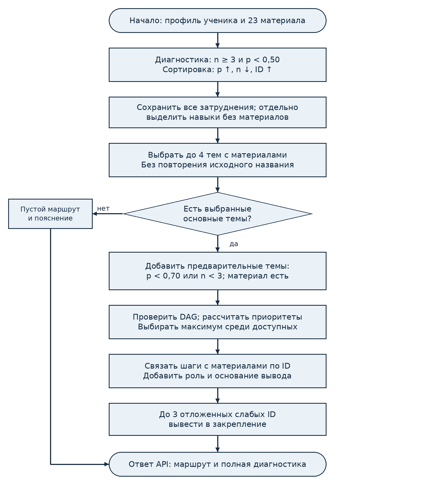

Из диагностированных навыков с материалами выбираются до четырёх основных тем. Один исходный текст названия включается в короткий основной маршрут один раз. Это устраняет повтор одинакового вводного чтения для Circle Graph, но не объединяет разные ID, коэффициенты и вероятности. Оставшиеся поддерживаемые затруднения могут попасть в reinforcement, где сохраняется до трёх ID. Необеспеченные материалами затруднения возвращаются в without_materials.

Для каждой основной темы рассматриваются входящие рёбра графа. Предварительная тема добавляется, если материал существует и её прогноз ниже 0,70 либо наблюдений меньше трёх. Если наблюдений достаточно и прогноз не ниже 0,70, отдельная подготовка пропускается. Рекурсивная функция допускает просмотр предков; в текущем графе цепочек глубже одного ребра нет. Общего жёсткого ограничения длины с учётом всех предков код не содержит: четыре — предел основных тем, а не итогового числа шагов.

rank() работает только по выбранному подмножеству и вычисляет приоритет по формуле (7).

$$ Q(s) = round[100(1−pₛ) + 15I(nₛ<3) + 8I(Bₛ), 1]. (7)

где pₛ — прогноз; nₛ — число наблюдений; I — индикатор выполнения условия; Bₛ — наличие включённого предварительного навыка с p<0,65 либо n<3. Пороги 0,50, 0,65 и 0,70 имеют разные функции и заданы вручную. Надбавка 15 обычно относится к добавленной предварительной теме: основная диагностированная тема уже имеет минимум три ответа.

Перед ранжированием topological() проверяет DAG. Затем из оставшихся вершин доступны только те, чьи выбранные предварительные темы уже размещены. Среди доступных выбирается максимум пары (priority, skill_id); при равенстве приоритета выбирается больший строковый ID. Таким образом, зависимости имеют преимущество перед числовой срочностью. Цикл приводит к ValueError, а не к выдаче некорректного порядка.

Каждый шаг получает role=focus либо prerequisite, прогноз, число ответов, наблюдаемую точность, reason и evidence_note. При 3–9 наблюдениях вывод прямо назван предварительным сигналом. Поле prerequisites содержит связи внутри маршрута, а all_prerequisites сохраняет входящие связи исходного графа. При отсутствии выбранных основных тем маршрут пуст, сопровождается пояснением и не заменяется каталогом.

### 2.1.6 Поиск учебных материалов

Материал в маршруте выбирается точным skill_id, поэтому ошибочное текстовое совпадение не может подменить тему. Для самостоятельного поиска Service.materials() вызывает search(). Текст запроса и название с объяснением разбиваются на слова, приводятся к нижнему регистру, у длинных русских слов удаляется одно подходящее окончание. Это ограниченная эвристическая нормализация, а не полноценный морфологический анализ.

Вес совпадения использует частоту слова в документе и обратную частоту по библиотеке log((N+1)/(df+1)). Попадание в название даёт дополнительный вес 2, полное совпадение названия — 4, точное совпадение skill_id при фильтрации — 5. Результат сортируется по убыванию веса и затем по ID. Это собственная взвешенная лексическая функция, а не утверждённая реализация BM25.

При нулевых лексических совпадениях поиск всё равно может вернуть первые документы по порядку ID; порог отказа не реализован. Поэтому найденный ресурс необходимо оценивать по теме и источнику. В маршруте этот риск устранён точным сопоставлением, а в свободном поиске остаётся направлением улучшения.

## 2.2 Макет приложения и проектирование данных

### 2.2.1 Пользовательский сценарий

Основной пользователь выбирает ученика, оценивает объём его истории, просматривает диагностику и переходит к маршруту. Раздел «Обзор ученика» отвечает на вопрос о доступных данных; «Оценка знаний» показывает навыки и обоснования сигналов; «Индивидуальная траектория» задаёт последовательность повторения; «Качество модели» объясняет, на каких результатах основан прогноз. Выбор ученика находится в боковой панели и применяется к текущему представлению.

Структурный макет на рисунке 2.4 построен по ui/app.py и ui/presentation.py. Он иллюстрирует организацию данных, а не воспроизводит браузерное отображение. Реальных скриншотов новой версии нет, поэтому схема не подменяет отсутствующую визуальную проверку.

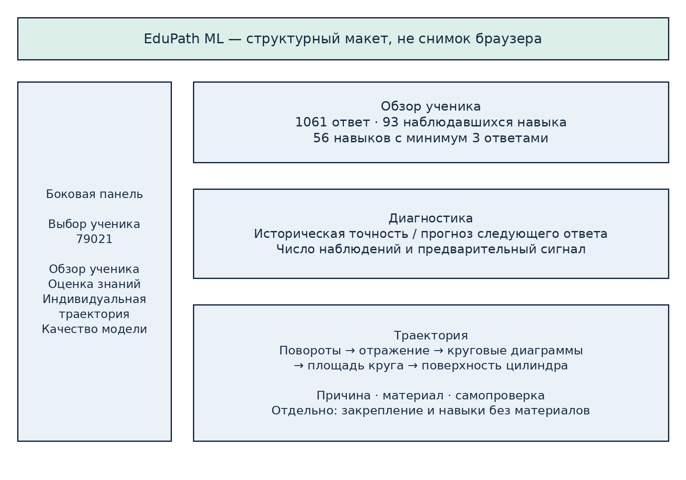

В обзоре ученика 79021 показываются 1061 ответ, 93 навыка с наблюдениями и 56 навыков хотя бы с тремя ответами. Число 149 относится к справочнику датасета. Отождествление всех записей профиля с изученными темами было бы неверным: профиль включает и навыки с нулевой историей, для которых модель даёт ограниченный прогноз по общим признакам и коэффициенту категории.

### 2.2.2 Организация представления результатов

ui/presentation.py содержит функции skill_label(), percent(), risk(), split_skills() и пояснения прогноза и позиции. Отображаемый русский заголовок берётся из материалов при наличии; исходная метка сохраняется отдельно. Повторяющиеся названия дополняются ID, чтобы пользователь мог различить четыре Circle Graph. Если название отсутствует, интерфейс использует обозначение навыка по ID и не придумывает содержание.

Историческая точность и вероятность следующего ответа показываются раздельно. Подпись «риск» относится к прогнозу, а не к измеренной тяжести пробела знаний. Навыки с 1–2 ответами и нулевой историей отделены от рейтинга диагностических затруднений. Карточка маршрута включает место, роль, причину, прогноз, число ответов, материал и источник. Для предварительного шага поясняется зависимая тема.

Короткие задания содержат вопрос и ответ для самостоятельной сверки. Нажатие или просмотр ответа не создаёт взаимодействие в SQLite, не изменяет счётчики и не вызывает predict() с новой историей. Поэтому нельзя описывать этот элемент как реализованное адаптивное повторное тестирование. Пользовательский сценарий завершает чтение и самопроверку, а не замкнутый цикл автоматической оценки.

### 2.2.3 Концептуальная и физическая схема SQLite

ER-диаграмма на рисунке 2.5 составлена по sqlite_master существующей data/demo/edupath.db. В таблице interactions объявлены два FOREIGN KEY, а у materials и prerequisites связи со skills существуют на уровне данных и кода. Эти различия отражены обозначениями схемы. Внешний ключ как декларация также не означает автоматического включения проверки на каждом соединении: для этого SQLite использует PRAGMA foreign_keys [8], а Service._db() его явно не устанавливает.

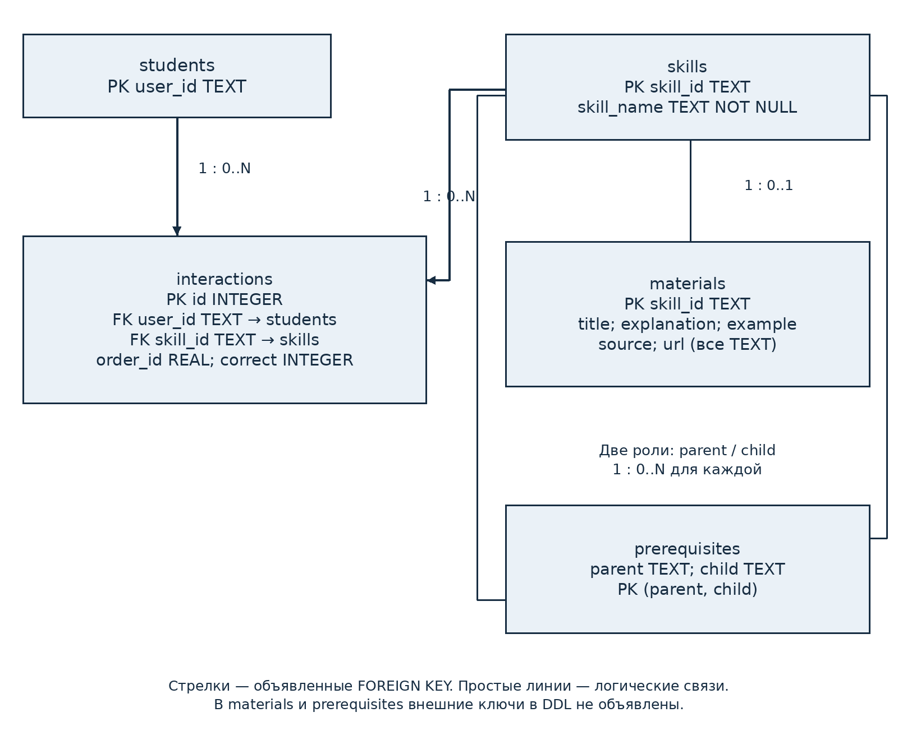

Таблица students хранит только строковый user_id как первичный ключ. Профильные персональные поля не вводятся, поскольку исходная задача требует анализа псевдонимизированных событий. skills содержит строковый skill_id и обязательный skill_name. Отсутствующее исходное название может заменяться самим ID; наличие непустого значения поэтому ещё не гарантирует известную педагогическую интерпретацию.

interactions хранит id INTEGER PRIMARY KEY, user_id TEXT, skill_id TEXT, order_id REAL и correct INTEGER. В DDL нет CHECK(correct IN (0,1)) и NOT NULL для этих полей; фактическая корректность обеспечивается очисткой перед загрузкой и проверками. Представлять такие ограничения как уже созданные в БД было бы неточно. Таблица 2.2 характеризует объёмы сущностей.

Таблица 2.2 — Сущности и фактический объём хранилища

| Таблица | Ключ и назначение | Строк |
|---|---|---:|
| students | user_id; множество учеников | 4163 |
| skills | skill_id; исходные метки | 149 |
| interactions | id; последовательные ответы | 283105 |
| materials | skill_id; учебное объяснение и источник | 23 |
| prerequisites | (parent, child); предварительная связь | 5 |

materials содержит skill_id, title, explanation, example, source и url; все поля текстовые. Первичный ключ skill_id означает не более одного материала на ID в текущей схеме. Для нескольких ресурсов на тему понадобилась бы отдельная сущность material с собственным ключом и таблица связи. Пока четыре Circle Graph представлены четырьмя записями с одинаковым вводным чтением, что не означает наличия четырёх разных курсов.

prerequisites содержит parent и child с составным первичным ключом. Пара уникальна, поэтому одинаковое ребро не дублируется. Физические FOREIGN KEY для этих двух столбцов не объявлены. Семантическая согласованность обеспечивается справочником реальных ID и аудитом; отсутствие циклов проверяет topological(). Запрет цикла нельзя выразить одним обычным внешним ключом.

Индекс interactions_user_order(user_id,order_id,id) соответствует основному запросу истории: WHERE user_id=? ORDER BY order_id,id. Он помогает получить события одного ученика в определённом порядке. Служебный id выступает последним критерием упорядочения. Для запроса всех навыков и каталога материалов отдельные индексы на текст объяснения не требуются при нынешнем объёме.

### 2.2.4 Логическая целостность и обновление базы знаний

Связь students–interactions имеет кардинальность один ко многим; одно событие принадлежит одному ученику. skills–interactions также является связью один ко многим. skills–materials — один к нулю или одной записи. Граф задаёт две связи skills–prerequisites: родительскую и дочернюю. Одна тема может иметь несколько потомков; в текущем графе навык 47 имеет два исходящих ребра.

scripts/sync_knowledge_base.py предназначен для отдельной миграции материалов и зависимостей. Он сверяет новые ID с точными метками, обновляет соответствующие таблицы и сохраняет отчёт с контрольными суммами модели и ML-эксперимента. Актуальная миграция уже выполнена: 23 материала и пять рёбер. Для подготовки записки она не запускалась повторно.

При дальнейшем развитии целесообразны явные FK материалов и графа, CHECK для бинарной цели и версионирование базы знаний. Это предложения, а не скрытые свойства действующей схемы. Текущая архитектура уже позволяет отделить такой инженерный этап от переобучения, поскольку коэффициенты и метрики лежат в независимых файлах.

### 2.2.5 Граф зависимостей навыков

На рисунке 2.6 изображены все пять реально сохранённых рёбер. Изолированные навыки не показаны ради читаемости; отсутствие вершины на рисунке не означает отсутствие навыка в каталоге. Граф охватывает умножение и деление дробей, перевод дробей и процентов, два уровня уравнений, площадь круга и поверхность цилиндра.

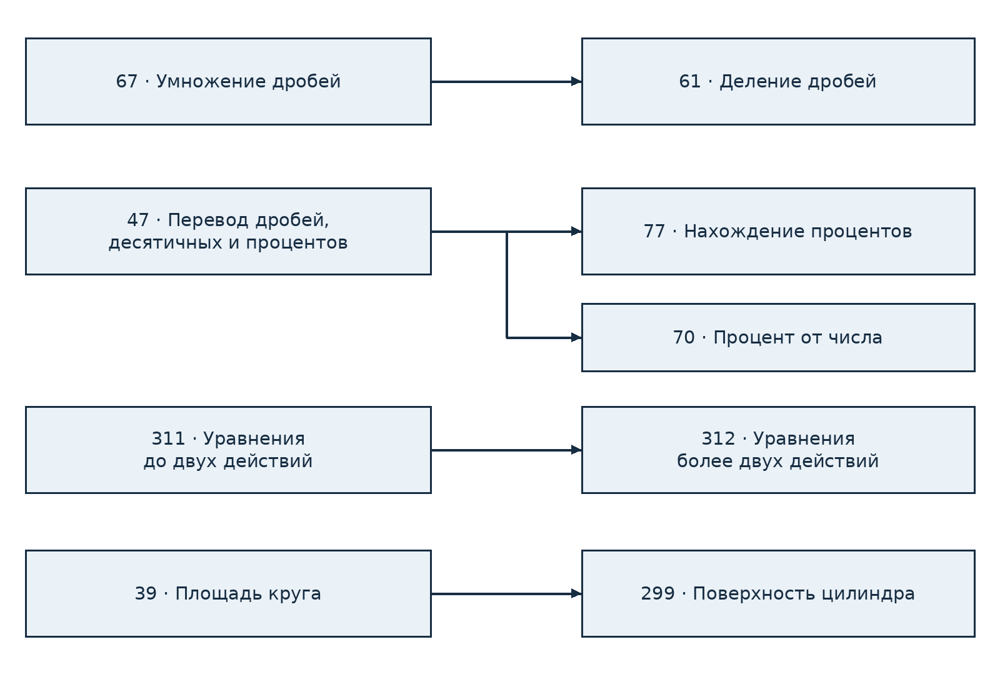

Рёбра 67→61, 47→77, 47→70 и 311→312 выражают вручную принятую последовательность повторения. Связь 39→299 имеет наглядное математическое объяснение: полная площадь поверхности цилиндра содержит два слагаемых площади круглого основания. OpenStax рассматривает площадь круга в разделе 9.5 [10], а в разделе 9.6 включает её в предварительную проверку перед объёмом и поверхностью тел [9]. Это поддерживает выбранную зависимость, но не заменяет экспертной проверки всего графа.

Для тем вероятности, поворотов и отражений дополнительные рёбра в текущую SQLite не внесены. Их нельзя дорисовывать как реализованные только потому, что связь кажется педагогически правдоподобной. Полнота карты предварительных знаний остаётся ограничением прототипа.

## 2.3 Описание программы

### 2.3.1 Структура модулей, классы и зависимости

Программное ядро разделено на пакеты data, ml, retrieval, recommendation и api; пользовательский слой вынесен в ui. Основной класс — Service. Он инкапсулирует пути db_path, model_path и report_path, а также операции чтения. Наследования предметных классов в проекте нет. Веб-маршруты являются функциями, а данные передаются словарями и списками, сериализуемыми в JSON.

Таблица 2.3 показывает ответственность основных файлов. Скрипты сборки и проверки находятся отдельно от библиотечного кода, чтобы действие запуска приложения не смешивалось с пересозданием артефактов.

Таблица 2.3 — Модули существующей реализации

| Файл | Основные функции и ответственность |
|---|---|
| src/data/dataset.py | load_assistments(), describe(); чтение и очистка |
| src/ml/model.py | features(), group_split(), train_logistic(), predict(), metrics() |
| src/recommendation/trajectory.py | topological(), rank(), personalized_plan() |
| src/retrieval/materials.py | REAL_MATERIALS, search(), add_practice() |
| src/api/service.py | Service; чтение SQLite и сборка профиля |
| src/api/app.py | FastAPI и обработка семи маршрутов |
| ui/app.py | Streamlit, выбор ученика и четыре раздела |
| ui/presentation.py | Названия, проценты, риск и пояснения |

Модуль данных не зависит от FastAPI или Streamlit. Модель использует стандартную библиотеку; рекомендатель при наличии NetworkX дополнительно проверяет DAG через DiGraph, а при отсутствии выполняет ту же проверку собственной топологической сортировкой. Граф хранится в SQLite; отдельная графовая СУБД не используется. Такой состав соответствует локальной системе, где прозрачность и доступность вычислений важнее распределённого масштабирования.

### 2.3.2 Построение профиля в Service

Service.ready() проверяет существование SQLite, модели и отчёта. Это проверка наличия файлов, а не полная верификация их содержимого. _db() открывает sqlite3-соединение и задаёт sqlite3.Row. SQL-запросы с пользовательским идентификатором используют параметры ?, что отделяет значение ID от текста запроса.

profile(user_id) сначала проверяет ученика в students, затем читает его события в порядке order_id,id, справочник навыков и заголовки материалов. Для каждого из 149 ID формируется подмножество событий, количество и число успехов. Модель загружается из JSON; для прогноза используются общая накопленная история и локальные счётчики навыка. Результат округляется до четырёх знаков.

Для каждого навыка возвращаются skill_id, исходное skill_name, display_name, observations, observed_accuracy, predicted_probability и текстовая характеристика объёма данных confidence. Последняя не является вероятностным доверительным интервалом. Профиль возвращает user_id, responses, общую observed_accuracy и список skills. Различие между исходной и отображаемой меткой позволяет сохранить связь с датасетом и одновременно предоставить русские заголовки.

Текущий расчёт проходит события отдельно для каждого навыка, то есть имеет порядок O(K×M) для K навыков и M ответов ученика, плюс сортировку итогового списка. При K=149 и максимуме 1061 ответ в текущем наборе это допустимо для демонстрации. При росте объёма можно за один проход накопить словарь счётчиков и получить O(K+M); такое улучшение в действующую реализацию не внесено.

### 2.3.3 Сборка ответа траектории

trajectory(user_id) получает profile(), читает материалы и рёбра, дополняет материалы статическими вопросами add_practice() и передаёт данные в personalized_plan(). Исходная метка отдельно записывается в dataset_skill_name. После расчёта план добавляется к профилю, поэтому API возвращает данные диагностики и рекомендации в одном согласованном объекте.

Обратная совместимость сохраняется для trajectory и trajectory_note. Дополнительные поля содержат detected_difficulties, without_materials, reinforcement, focus_skill_ids, prerequisite_skill_ids, material_count и selection_rule. Идентификаторы основных тем отражают порядок диагностического отбора; окончательный порядок шагов следует читать из trajectory, поскольку граф может его изменить.

Фрагмент ниже воспроизводит существенную часть существующего отбора. Его назначение — показать соответствие описания конкретным условиям кода, а не предложить иной алгоритм.

```python
diagnosed = sorted(
    (x for x in profile
     if x['observations'] >= MIN_DIAGNOSTIC_ANSWERS
     and x['predicted_probability'] < WEAK_FORECAST),
    key=lambda x: (x['predicted_probability'],
                   -x['observations'], x['skill_id'])
)
```

Константы MIN_DIAGNOSTIC_ANSWERS=3, WEAK_FORECAST=0.5 и MAX_FOCUS=4 заданы в модуле рекомендателя. Словарь material_byid отвечает только за доступность ресурса. При расширении каталога диагностические прогнозы не меняются, но некоторые ранее неподдерживаемые затруднения могут впервые стать кандидатами маршрута. Поэтому обновление рекомендаций требует функциональной проверки даже без переобучения модели.

### 2.3.4 API и обработчики запросов

FastAPI-приложение создаётся с заголовком EduPath ML. Перед большинством обработчиков require_ready() проверяет наличие артефактов. При их отсутствии возвращается HTTP 503. Сообщение в текущем коде упоминает скрипт сборки; при наличии готовых файлов обычный пользователь не должен запускать пересоздание БД для открытия интерфейса.

Маршруты и параметры приведены в таблице 2.4. Все перечисленные операции читают данные. Документация /docs и спецификация OpenAPI предоставляются инфраструктурой FastAPI дополнительно к семи прикладным маршрутам.

Таблица 2.4 — Прикладной контракт API

| GET-маршрут | Результат и контроль параметров |
|---|---|
| /health | Наличие артефактов и обозначение данных |
| /students | Список учеников; limit от 1 до 100 |
| /students/{user_id}/profile | Профиль; неизвестный user_id даёт 404 |
| /students/{user_id}/trajectory | Профиль и персональный план; 404 для неизвестного ID |
| /skills | Каталог навыков |
| /materials | Поиск по query, точный skill; limit от 1 до 50 |
| /model/info | Сохранённое описание ML-эксперимента |

Ограничения Query дают 422 для параметра вне допустимого диапазона [6]. Методы profile() и trajectory() перехватывают KeyError и преобразуют его в 404 «Ученик не найден». Обычное получение данных не должно изменять модель или взаимодействия. Аутентификация и журналирование доступа не реализованы; при публикации за пределами локальной демонстрации потребуется отдельное проектирование этих функций.

Основной Streamlit получает JSON через requests по EDUPATH_API, по умолчанию http://127.0.0.1:8000. Резервный scripts/smoke_server.py использует тот же Service и стандартную библиотеку, но его /docs является перечнем путей, а не Swagger. ui/fallback.html — отдельный упрощённый интерфейс; его нельзя использовать как доказательство актуального вида Streamlit.

### 2.3.5 Обработчики действий интерфейса

Переключение radio-навигации и выбор ученика инициируют обычное повторное выполнение Streamlit-скрипта. В зависимости от раздела выполняются запросы профиля, траектории или информации о модели. Представление строится из возвращённых полей, а не из вручную вставленного маршрута контрольного ученика. Это позволяет тем же кодом показывать примеры длиной пять, два и четыре шага.

Карточки используют HTML/CSS и экранирование текста; простые полосы визуализируют вероятности. Связи поясняются стрелками и названиями предварительных тем. Оформление помогает проследить причину шага, но оценка точного переноса строк и отступов требует браузера. В этой работе содержательные результаты интерфейса подтверждаются AppTest, а его пиксельное отображение отдельно не заявляется.

### 2.3.6 Проверки и воспроизводимость

Критические инварианты представлены проверками причинности, непересечения учеников, диапазона вероятностей, порядка графа, отбора тем, отсутствия подстановки каталога и формата API. Существующие тесты используют unittest, хотя исходное техническое задание предлагало pytest. В записке описан фактически применённый инструмент; дополнительный запуск pytest не выдумывается.

Ранее полный набор прошёл 21/21. Последняя связанная проверка включала 17 тестов RecommendationTests, ServiceTests, APITests и PresentationTests, без DataTests и без обучения. Отдельные отчёты AppTest и ASGI проверяют разные границы интеграции. Настоящая подготовка документа не меняет эти отчёты и не превращает их в новый полный прогон.

Сохранённые контрольные суммы позволяют отделить изменения базы знаний от обучения. Для models/model.json SHA-256 равен dc03cf614cbf85aaa45266f1c09b6d6f5a1aad17f0876503a10771eb809b5c44, для reports/experiment.json — 7b1c6e8bee333414587f7c1c116153d92bce20f81cb27077ab731496a7e44372. Эти артефакты при подготовке записки сохраняются неизменными.

## 2.4 Результаты работы программы

### 2.4.1 Входные данные и профиль

Исходный файл содержит 346 860 строк и 31 столбец; его размер равен 64 412 812 байтам. После очистки используются все 283 105 пригодных ответов. Метаданные загрузки согласуются с идентификатором исправленного collapsed-файла на официальной странице [3]; независимой издательской контрольной суммы нет. Локальный SHA-256 сохранён в reports/raw_eda.json и приложении Б.

Фактический баланс и состав после обработки приведены в таблице 2.5. Из 149 ID не следует наличие 149 разных названий: исходных текстовых меток 112, некоторые повторяются. reports/eda.json содержит также распределение по названиям, которое нельзя автоматически трактовать как распределение по отдельным ID.

Таблица 2.5 — Результат очистки и характеристика истории

| Показатель | Значение |
|---|---:|
| Исходные строки | 346860 |
| Исключённые строки | 63755 |
| Пригодные ответы | 283105 |
| Правильные / ошибочные | 186322 / 96783 |
| Доля правильных ответов | 65,81% |
| Ученики / ID навыков / названия | 4163 / 149 / 112 |
| Ответов на ученика: минимум / медиана / максимум | 1 / 20 / 1061 |
| Повторы user_id–order_id | 0 |

Распределение целевой переменной изображено на рисунке 2.7. Преобладание положительного класса объясняет, почему постоянное предсказание «правильно» получает относительно высокую Accuracy и F1. График построен по сохранённым целевым счётчикам, без повторного обучения.

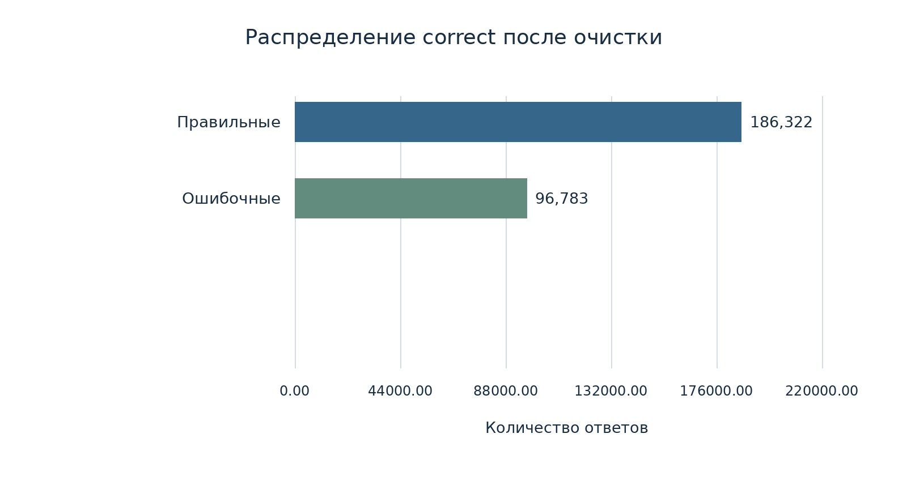

### 2.4.2 Подробный разбор ученика 79021

Service возвращает 1061 ответ и профиль 149 ID; наблюдения есть по 93 навыкам, минимум три ответа — по 56. Диагностика выявляет 17 слабых ID. Семь из них не имеют материала, включая неизвестный по содержанию ID 76. Основных тем выбрано четыре: 292, 299, 290 и 2_37_70. Добавлена предварительная тема 39.

Фактический окончательный маршрут раскрыт в таблице 2.6. Значения получены чтением действующего Service над сохранёнными артефактами. Округление процентов соответствует вероятности из профиля, а число приоритета — формуле (7).

Таблица 2.6 — Пять шагов маршрута ученика 79021

| Шаг и навык | n | Прогноз | Приоритет | Роль |
|---|---:|---:|---:|---|
| 1. Повороты, 292 | 3 | 6,87% | 93,1 | Основная |
| 2. Отражение, 290 | 5 | 21,56% | 78,4 | Основная |
| 3. Круговые диаграммы, 2_37_70 | 4 | 27,61% | 72,4 | Основная |
| 4. Площадь круга, 39 | 22 | 48,30% | 51,7 | Подготовка |
| 5. Поверхность цилиндра, 299 | 4 | 18,87% | 89,1 | Основная |

Сначала максимальный доступный приоритет имеют повороты. Цилиндр имеет 89,1, но заблокирован до размещения площади круга. Поэтому отражение и круговые диаграммы оказываются раньше, затем выполняется подготовка и становится доступен цилиндр. Пример показывает, почему простая сортировка по возрастанию вероятности не воспроизводит итоговый результат.

У поворотов только три ответа и нулевая наблюдаемая точность. Это предварительный сигнал, а не надёжная диагностика. Для площади круга наблюдаемая точность составляет 6/22=27,27%, тогда как прогноз равен 48,30%; величины различаются из-за общих исторических признаков, коэффициента навыка и сглаживания. Площадь круга сама удовлетворяет диагностическому порогу, но включена как предварительная тема после выбора четырёх основных.

На рисунке 2.8 показаны вероятности в порядке маршрута. Немонотонность графика является ожидаемым следствием зависимости 39→299. Другой слабый Circle Graph ID 2_37_48_77 остаётся отдельно в диагностике и может присутствовать в закреплении; вероятности двух ID не усредняются.

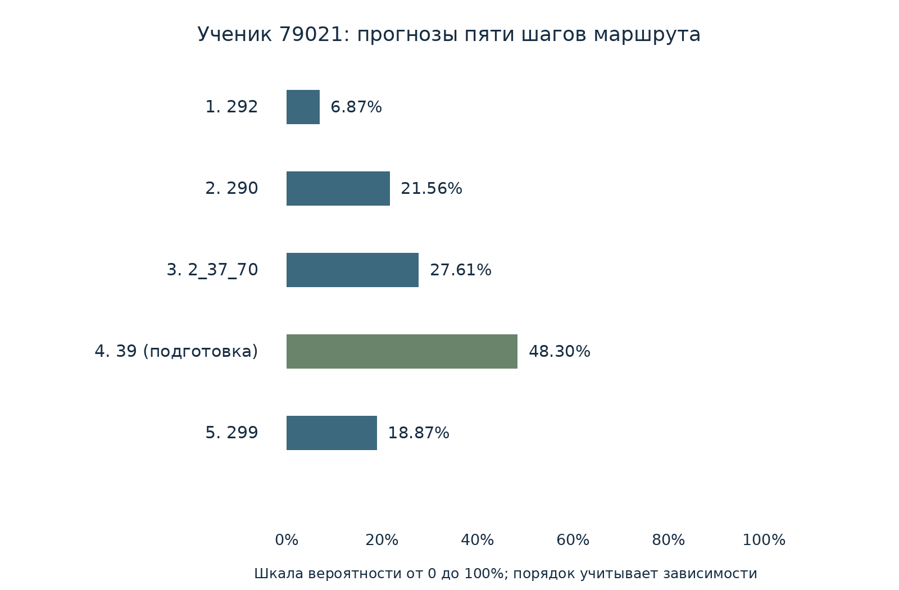

### 2.4.3 Другие сценарии и пустая рекомендация

Таблица 2.7 содержит ещё два контрольных профиля и сценарий отсутствия маршрута. Они демонстрируют применение общих правил к разным историям, но не являются статистической оценкой всех пользователей.

Таблица 2.7 — Воспроизводимые контрольные маршруты

| Ученик | Ответов | Маршрут по ID | Шагов |
|---|---:|---|---:|
| 79021 | 1061 | 292 → 290 → 2_37_70 → 39 → 299 | 5 |
| 75169 | 1029 | 292 → 9_12 | 2 |
| 78970 | 1014 | 16_17 → 290 → 17 → 294 | 4 |
| 21825 | 17 | Пустой; подходящих слабых тем не выявлено | 0 |

Для 75169 прогноз поворотов равен 17,25% при четырёх ответах, диаграммы «стебель и листья» — 48,85% при трёх. Оба сигнала предварительные. Для 78970 выбираются методы подсчёта, отражение, вероятность двух событий и площадь неправильной фигуры; прогнозы соответственно 20,31%, 32,23%, 35,23% и 36,82%. По вероятности двух событий имеется 28 ответов, по остальным выбранным темам — по четыре.

У 21825 нет подходящих диагностических тем и возвращается объяснённый пустой маршрут. Этот ученик также указан в аудите как не имеющий наблюдений по поддерживаемым материалами навыкам. В данном примере основание пустоты, возвращённое самим алгоритмом, — отсутствие выявленных низких прогнозов при минимуме трёх ответов; нельзя приписывать ему только нехватку материалов.

### 2.4.4 Библиотека и выходные артефакты

В библиотеке 23 записи, связанные с 23 из 149 ID. Им соответствуют 125 669 ответов и 3119 учеников с хотя бы одним таким ответом. Четыре одинаковых вводных чтения Circle Graph снижают число уникальных содержательных материалов относительно числа записей. Показатели охвата имеют разные знаменатели и представлены на рисунке 2.9.

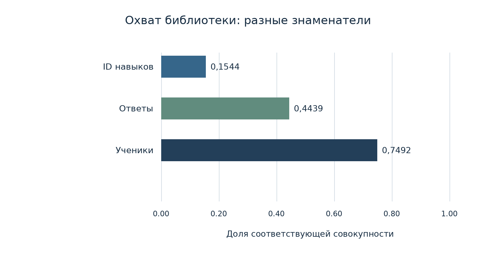

Доля поддерживаемых ID равна 15,44%, доля ответов — 44,39%, доля учеников с хотя бы одним поддерживаемым навыком — 74,92%. Последняя величина не означает, что все затруднения этих учеников обеспечены материалами. Дополнительные диагностические сигналы без ресурсов прямо показывают неполноту базы знаний.

Результаты сохранены в SQLite, models/model.json и reports/experiment.json; отчёты EDA, интеграции и контрольных маршрутов разделены по назначению. Такой набор позволяет воспроизвести конкретный вывод и отличить изменение рекомендаций от изменения ML-модели. Вывод по второй главе: реализована сквозная цепочка от очищенного события до объяснённого шага маршрута, а обработка пустого результата и ограниченного покрытия входит в нормальное поведение приложения.

# 3 РЕЗУЛЬТАТЫ И ВЫВОДЫ

## 3.1 Анализ полученных результатов

### 3.1.1 Схема эксперимента и сопоставляемые методы

Оценка выполнена на 59 642 ответах 833 учеников, не входивших в обучение. Выборка test зафиксирована seed=42. Для каждого события прогноз вычислялся до текущего ответа, а ранее состоявшиеся ответы того же тестового ученика учитывались в истории. Повторного подбора гиперпараметров по отдельной validation-выборке не описано; доверительные интервалы и повторения по нескольким seed не рассчитывались.

Константный метод использует частоту успеха train. Историческое правило history_predict() смешивает сглаженную прежнюю успешность по навыку с константой, придавая ей вес четырёх условных наблюдений. Логистическая регрессия обучает совместные веса общих и локальных признаков. Все три метода оцениваются на одном test, что делает численные результаты сопоставимыми в рамках данного разбиения.

В таблицах 3.1 и 3.2 приведены исходные метрики reports/experiment.json с округлением до четырёх знаков. Разделение на две таблицы сохраняет читаемость при формате А4. Модель при доработке рекомендателя и подготовке записки не переобучалась.

Таблица 3.1 — Классификационные метрики при пороге 0,5

| Метод | Accuracy | Precision | Recall | F1 |
|---|---:|---:|---:|---:|
| Константа | 0,6562 | 0,6562 | 1,0000 | 0,7924 |
| Историческое правило | 0,6862 | 0,7040 | 0,9005 | 0,7902 |
| Logistic SGD | 0,7121 | 0,7393 | 0,8670 | 0,7981 |

Таблица 3.2 — Ранжирование и ошибки вероятностного прогноза

| Метод | ROC-AUC ↑ | Log Loss ↓ | Brier ↓ |
|---|---:|---:|---:|
| Константа | 0,5000 | 0,6435 | 0,2256 |
| Историческое правило | 0,6670 | 0,6069 | 0,2088 |
| Logistic SGD | 0,7276 | 0,5653 | 0,1914 |

Константа предсказывает положительный класс для всех строк, поэтому Recall=1,0 и F1=0,7924 не означают распознавания ошибок ученика. Logistic SGD снижает Recall положительного класса, но повышает Precision и Accuracy, а также улучшает качество вероятностей. Историческое правило уже превосходит константу по Log Loss и ROC-AUC, что поддерживает полезность прошлых ответов как сигнала.

### 3.1.2 Интерпретация графиков

На рисунке 3.1 показан Log Loss трёх методов. Абсолютное улучшение Logistic SGD относительно константы составляет 0,0783, относительное — около 12,17%; относительно исторического правила снижение равно 0,0416. Эти производные числа рассчитаны из сохранённых метрик и не являются новым экспериментом.

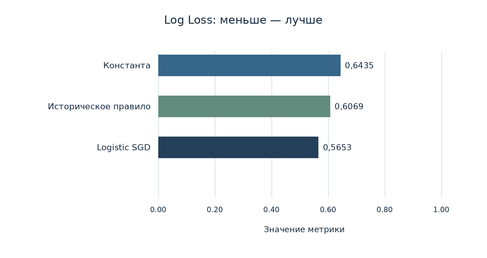

Рисунок 3.2 отражает рост ROC-AUC от 0,5000 у константы до 0,7276 у модели. Сам ROC-график построить по одной агрегированной ROC-AUC нельзя: необходимы исходные вероятности и метки всех test-событий. Поэтому в работе приведено корректное сравнение столбцов, а не вымышленная ROC-кривая.

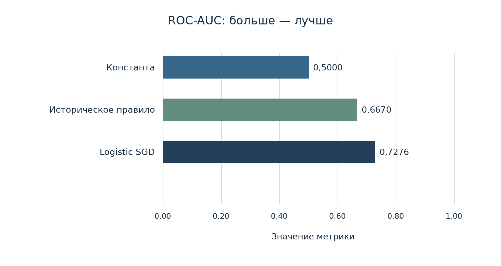

Brier Score на рисунке 3.3 снижается с 0,2256 до 0,1914, то есть приблизительно на 15,16%. Однако меньшая квадратичная ошибка ещё не доказывает корректную калибровку вблизи диагностического порога 0,50. Для проверки порогов потребуется анализ по интервалам прогноза и отдельным группам учеников.

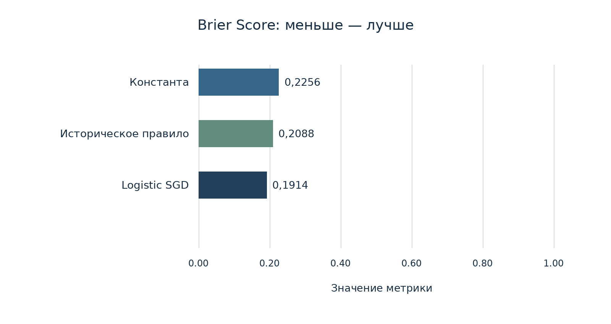

Рабочая гипотеза об улучшении вероятностного прогноза подтверждена на одном зафиксированном разбиении. Статистическая значимость различий и перенос на другую LMS не установлены. Метрики усредняются по ответам, поэтому ученики с длинными историями имеют больший вклад. Дополнительная оценка с равным весом учеников могла бы выявить иной профиль качества.

## 3.2 Оценка эффективности выбранного подхода и технологий

### 3.2.1 Вычислительные ресурсы

Сохранённый отчёт указывает 13,928 с на обучение Logistic SGD. По записи предыдущей сборки внешнее время всего процесса составило 20,67 с, пик памяти — около 307 МиБ. Эти величины относятся к одному запуску в тогдашнем окружении; повторное измерение в ходе подготовки документа не проводилось. Они не являются гарантией производительности на любой машине.

reports/system_evaluation.json содержит измерение прямого вызова обработчика: медиана 14,986 мс, p95 20,008 мс. HTTP-транспорт исключён, поскольку сокеты в среде были запрещены. Поэтому запись нельзя обозначать как задержку сетевого API. Имеющиеся исторические измерения в PROGRESS.md относятся к другим состояниям; для настоящего анализа выбран текущий сохранённый отчёт.

Подготовка признаков требует сортировки событий порядка O(N log N) и одного прохода O(N); число состояний определяется учениками и наблюдавшимися парами ученик–навык. Разрежённое обучение выполняет постоянное число обновлений на событие каждой эпохи. Проверка графа собственным алгоритмом имеет O(V+E), но жадное повторное выделение доступных шагов в rank() при прямом просмотре оставшихся вершин имеет квадратичную составляющую. Для нынешних коротких маршрутов это несущественно; оптимизация очередью приоритетов понадобилась бы для значительно большего графа.

### 3.2.2 Проверки интеграции и их границы

Таблица 3.3 отделяет подтверждения разных уровней. Предыдущие результаты не заменяются утверждением, что вся новая версия проверена в браузере. При подготовке записки выполнены только чтение артефактов и проверки самого документа; программная модель и результаты тестов сохранены.

Таблица 3.3 — Фактически выполненные проверки приложения

| Проверка | Результат | Граница подтверждения |
|---|---|---|
| Прежний полный unittest | 21/21 | Исторический полный запуск |
| Последние связанные тесты | 17/17 | Рекомендации, сервис, API, представление; без DataTests |
| Streamlit AppTest local-service | Пройден; маршруты 5/2/4 | requests.get заменён ответами Service; без HTTP |
| ASGI FastAPI | Пройден; 149 ID, 23 материала, 404/422 | Прямой обработчик вместо стандартного пула потоков |
| Сетевой HTTP новой версии | Не подтверждён | Требуется запуск вне ограниченной среды |
| Браузер и скриншоты новой версии | Не подтверждены | AppTest не проверяет пиксельную вёрстку |

ASGI-smoke использует настоящее приложение и маршрутизацию, но fastapi.routing.run_in_threadpool заменён прямым исполнением синхронного обработчика из-за зависания AnyIO-worker в ограниченной среде. Поэтому подтверждены сериализация, обработка путей и содержание ответа; стандартный пул потоков не проверен. AppTest проверяет реальные Streamlit-элементы, но его сетевой источник в local-service подменён. Оба результата полезны и взаимно дополняются, не образуя полного сетевого end-to-end испытания.

### 3.2.3 Оценка поиска и рекомендаций

Девять ручных запросов дали Hit@1=9/9. В них входят сложение, умножение и деление дробей, перевод дроби в процент, нахождение процентов, процент от числа, пропорция и два уровня линейных уравнений. Набор относится к прежнему тематическому ядру библиотеки. Он подтверждает отдельные известные формулировки, но не оценивает качество поиска по всем 23 записям, неопределённым запросам и перефразировкам.

Три разных маршрута и проверка пустого результата подтверждают применение персональных правил. Порядок 39 перед 299 подтверждает соблюдение выбранной зависимости. Это функциональная корректность относительно формализованных правил. Она не равнозначна независимой экспертной оценке педагогической уместности и не показывает, что ученик после маршрута будет решать лучше.

Потребность в материалах анализировалась по всем профилям в reports/skill_demand.json. Например, выявленные затруднения встречались у 196 учеников для ID 47, у 195 для ID 277 и у 176 для неизвестного по названию ID 76. Расширение библиотеки помогает техническому покрытию, но неизвестную семантику ID нельзя заменять догадкой даже при высокой частоте сигнала.

## 3.3 Сравнение с альтернативными решениями

Таблица 3.4 разделяет фактически оценённые и перспективные методы. Такое сопоставление помогает обосновать стек, не создавая несуществующих результатов. Нет основания утверждать, что Logistic SGD численно превзошла случайный лес или нейросеть: соответствующие эксперименты отсутствуют.

Таблица 3.4 — Альтернативы и фактический статус

| Решение | Возможности и ограничения | Статус |
|---|---|---|
| Константа | Минимальная база; не различает историю | Оценена на test |
| Историческое правило | Быстро учитывает прежние ответы по навыку | Оценено на test |
| Logistic SGD | Совместные веса истории и навыка; линейные ограничения | Реализована и оценена |
| Случайный лес | Нелинейные зависимости; отдельная настройка вероятностей | Не реализован в эксперименте |
| Последовательная нейромодель | Возможен более сложный учёт истории; больше требований | Не реализована |
| Векторный поиск и RAG | Иная обработка текста; нужны модель и оценка | Не реализованы |

SQLite и локальный JSON достаточны для учебной демонстрации с готовыми артефактами. Серверная СУБД может быть обоснована при одновременной записи многих пользователей, но текущая задача этого не проверяет. Аналогично NetworkX используется как необязательная проверка графа, а не как обязательная графовая инфраструктура.

Для инженерного прототипа выбранный подход эффективен по объёму зависимостей, скорости сохранённого эксперимента и объяснимости. Его исследовательская сила ограничивается одним набором и разбиением, небольшой базой материалов и отсутствием проверки образовательного эффекта. Эти ограничения определяют направления развития, а не отменяют подтверждённое улучшение вероятностного прогноза.

## 3.4 Ограничения и дальнейшая работа

Приоритетное завершение интеграции — запустить существующие API и Streamlit в обычной Ubuntu, выполнить сетевые smoke и визуально осмотреть три профиля. Для этого не требуется обучение. Только после успешной проверки следует сохранить настоящие скриншоты; структурные рисунки настоящей работы ими не являются.

Следующий исследовательский этап — оценить калибровку, устойчивость при нескольких групповых разбиениях и качество по длине истории, навыкам и ученикам. Выбор вероятностных порогов следует проверять на отдельной валидации, а педагогический смысл сигналов — с экспертами. Доверительные интервалы нужно строить с учётом группировки событий по ученикам.

Для рекомендателя важны увеличение содержательного покрытия, проверка рёбер и ограничения длины при появлении глубоких цепочек. Для свободного поиска требуется расширенная выборка запросов с отрицательными примерами и правило отказа при отсутствии совпадений. Для повторного тестирования нужны банк заданий с привязкой к ID, запись попыток и оценка новых ответов; текущая статическая самопроверка эти задачи не решает.

Скрипт регистрации готовых экспериментов в MLflow существует, но пакет отсутствует и регистрация не подтверждена. Поэтому MLflow описывается как дополнительный организационный шаг. Педагогический эксперимент должен отдельно сравнить результаты учеников до и после работы с маршрутами, с подходящей контрольной группой и заранее определёнными показателями. В имеющихся логах такого исследования нет.

# ЗАКЛЮЧЕНИЕ

В ходе работы разработан и исследован прототип EduPath ML, связывающий историю ответов с профилем навыков и объяснимым порядком повторения. Исследованы исправленные collapsed-данные ASSISTments; после очистки сохранены 283 105 ответов 4163 учеников и 149 ID навыков. Реализованы исторические признаки до текущего ответа и групповое разделение без пересечения учеников.

Собственная логистическая регрессия SGD на фиксированном test получила Accuracy 0,7121, F1 0,7981, ROC-AUC 0,7276, Log Loss 0,5653 и Brier 0,1914. Вероятностные ошибки ниже, чем у постоянной частоты и исторического правила. Рабочая гипотеза об улучшении прогноза поддерживается данным offline-экспериментом; статистическая устойчивость и перенос на другие платформы требуют дальнейших проверок.

Спроектированы SQLite из пяти таблиц, модульный сервис, семь прикладных API-маршрутов и четыре раздела Streamlit. Актуальный рекомендатель выбирает до четырёх выявленных слабых тем с материалами, добавляет необходимые предварительные знания и сохраняет отдельно неподдерживаемые затруднения и закрепление. Библиотека включает 23 записи, граф — пять рёбер. Для ученика 79021 получен маршрут из пяти шагов, для двух других контрольных учеников — из двух и четырёх.

Функциональная состоятельность подтверждается прежним полным запуском 21/21, последними 17 связанными тестами, локальным Streamlit AppTest и ASGI-проверкой с указанными подменами. Реальный HTTP, стандартный пул потоков и браузерный вид новой версии не подтверждены. Педагогическая эффективность маршрутов не измерена. Тем самым цель достигнута на уровне исследовательского прототипа; дальнейшая работа связана с внешней интеграционной проверкой, калибровкой, экспертной валидацией базы знаний и проверкой учебного эффекта.

# СПИСОК ИСПОЛЬЗОВАННЫХ ИСТОЧНИКОВ

1. Методические указания по выполнению курсовой работы по дисциплине «Технологии программирования». — Ставрополь : Северо-Кавказский федеральный университет, 2025. — Локальный файл methodics_coursework.pdf.

2. Сборник лабораторных работ. Раздел «Лабораторная работа № 13–18: Сквозной проект». — Локальный файл labs_13_18.pdf, предоставленный в составе задания; иные выходные данные не установлены.

3. ASSISTmentsData. Skill-builder data 2009–2010 [Электронный ресурс]. — URL: https://sites.google.com/site/assistmentsdata/home/2009-2010-assistment-data/skill-builder-data-2009-2010 (дата обращения: 09.11.2026).

4. Vie J.-J., Kashima H. Knowledge Tracing Machines: Factorization Machines for Knowledge Tracing // Proceedings of the AAAI Conference on Artificial Intelligence. — 2019. — Vol. 33, no. 1. — P. 750–757. — DOI: 10.1609/aaai.v33i01.3301750. — Доступная авторская версия: https://arxiv.org/abs/1811.03388 (дата обращения: 09.11.2026).

5. Scikit-learn developers. Metrics and scoring: quantifying the quality of predictions [Электронный ресурс]. — URL: https://scikit-learn.org/stable/modules/model_evaluation.html (дата обращения: 09.11.2026). — Источник определений метрик; пакет не использован для обучения проекта.

6. FastAPI. Query Parameters and String Validations [Электронный ресурс]. — URL: https://fastapi.tiangolo.com/tutorial/query-params-str-validations/ (дата обращения: 09.11.2026).

7. Streamlit. st.testing.v1.AppTest [Электронный ресурс]. — URL: https://docs.streamlit.io/develop/api-reference/app-testing/st.testing.v1.apptest (дата обращения: 09.11.2026).

8. SQLite. SQLite Foreign Key Support [Электронный ресурс]. — URL: https://www.sqlite.org/foreignkeys.html (дата обращения: 09.11.2026).

9. OpenStax. Prealgebra 2e. 9.6 Solve Geometry Applications: Volume and Surface Area [Электронный ресурс]. — URL: https://openstax.org/books/prealgebra-2e/pages/9-6-solve-geometry-applications-volume-and-surface-area (дата обращения: 09.11.2026).

10. OpenStax. Prealgebra 2e. 9.5 Solve Geometry Applications: Circles and Irregular Figures [Электронный ресурс]. — URL: https://openstax.org/books/prealgebra-2e/pages/9-5-solve-geometry-applications-circles-and-irregular-figures (дата обращения: 09.11.2026).

11. EduPath ML. Исходные тексты, SQLite и отчёты экспериментов [Электронный ресурс]. — Локальные каталоги src/, ui/, data/demo/, models/, reports/; передача состояния CODEX_HANDOFF.md и docs/FINAL_STATUS.md. — Состояние, изученное при подготовке работы: 09.11.2026.

12. Long P., Siemens G. Penetrating the Fog: Analytics in Learning and Education // EDUCAUSE Review. — 2011. — Электронная версия от 12 сентября 2011 г. — URL: https://er.educause.edu/articles/2011/9/penetrating-the-fog-analytics-in-learning-and-education (дата обращения: 10.11.2026).

13. Peng H., Ma S., Spector J. M. Personalized adaptive learning: an emerging pedagogical approach enabled by a smart learning environment // Smart Learning Environments. — 2019. — Vol. 6. — Article 9. — DOI: 10.1186/s40561-019-0089-y. — URL: https://link.springer.com/article/10.1186/s40561-019-0089-y (дата обращения: 10.11.2026).

14. Corbett A. T., Anderson J. R. Knowledge tracing: Modeling the acquisition of procedural knowledge // User Modeling and User-Adapted Interaction. — 1994. — Vol. 4. — P. 253–278. — DOI: 10.1007/BF01099821. — URL: https://link.springer.com/article/10.1007/BF01099821 (дата обращения: 10.11.2026).

15. Tarus J. K., Niu Z., Mustafa G. Knowledge-based recommendation: a review of ontology-based recommender systems for e-learning // Artificial Intelligence Review. — 2018. — Vol. 50. — P. 21–48. — DOI: 10.1007/s10462-017-9539-5. — URL: https://link.springer.com/article/10.1007/s10462-017-9539-5 (дата обращения: 10.11.2026).

16. Leite da Silva F., Slodkowski B. K., Araújo da Silva K. K., Cazella S. C. A systematic literature review on educational recommender systems for teaching and learning: research trends, limitations and opportunities // Education and Information Technologies. — 2023. — Vol. 28. — P. 3289–3328. — DOI: 10.1007/s10639-022-11341-9. — URL: https://link.springer.com/article/10.1007/s10639-022-11341-9 (дата обращения: 10.11.2026).

17. SQLite. Appropriate Uses For SQLite [Электронный ресурс]. — URL: https://www.sqlite.org/whentouse.html (дата обращения: 10.11.2026).

18. FastAPI. Features [Электронный ресурс]. — URL: https://fastapi.tiangolo.com/features/ (дата обращения: 10.11.2026).

19. Streamlit. Basic concepts of Streamlit [Электронный ресурс]. — URL: https://docs.streamlit.io/get-started/fundamentals/main-concepts (дата обращения: 10.11.2026).

# ПРИЛОЖЕНИЕ А

## Физическая схема и примеры запросов

Ниже приведён DDL существующей SQLite, включая фактически объявленные ограничения. Логические связи materials и prerequisites со skills не представлены как несуществующие FOREIGN KEY.

```sql
CREATE TABLE students(user_id TEXT PRIMARY KEY);
CREATE TABLE skills(
    skill_id TEXT PRIMARY KEY, skill_name TEXT NOT NULL
);
CREATE TABLE interactions(
    id INTEGER PRIMARY KEY,
    user_id TEXT, skill_id TEXT,
    order_id REAL, correct INTEGER,
    FOREIGN KEY(user_id) REFERENCES students(user_id),
    FOREIGN KEY(skill_id) REFERENCES skills(skill_id)
);
CREATE TABLE materials(
    skill_id TEXT PRIMARY KEY, title TEXT,
    explanation TEXT, example TEXT, source TEXT, url TEXT
);
CREATE TABLE prerequisites(
    parent TEXT, child TEXT, PRIMARY KEY(parent,child)
);
CREATE INDEX interactions_user_order
    ON interactions(user_id,order_id,id);
```

Основной запрос истории использует параметризованный идентификатор. Параметр передаётся отдельно от SQL-строки:

```sql
SELECT * FROM interactions
WHERE user_id=? ORDER BY order_id,id;
```

Проверка покрытия библиотеки может быть воспроизведена чтением БД:

```sql
SELECT COUNT(*) FROM interactions i
JOIN materials m ON i.skill_id=m.skill_id;
-- Фактический результат: 125669
SELECT COUNT(DISTINCT i.user_id) FROM interactions i
JOIN materials m ON i.skill_id=m.skill_id;
-- Фактический результат: 3119
```

# ПРИЛОЖЕНИЕ Б

## Артефакты, контрольные суммы и происхождение чисел

Таблица Б.1 связывает разделы работы с локальными первичными артефактами. Ссылки на эти файлы позволяют проверить показатели без повторного обучения.

Таблица Б.1 — Источники фактических результатов

| Артефакт | Какие утверждения подтверждает |
|---|---|
| reports/raw_eda.json | Состав CSV, пропуски, повторы, локальный хеш |
| reports/experiment.json | Разбиение, 18 эпох, время обучения и метрики |
| reports/model_metrics.csv | Числа трёх сравниваемых методов |
| reports/integration_audit.json | 23 материала, пять рёбер и покрытие |
| reports/system_evaluation.json | Девять запросов, три маршрута, прямые задержки |
| reports/knowledge_base_sync.json | Миграция базы знаний без изменения модели |
| reports/asgi_integration.json | ASGI-пути, статусы и режим подмены |
| reports/streamlit_apptest_local.json | Три ученика, четыре раздела и local-service |

SHA-256 исходного CSV:

162ef8d2d28bcbfea6591a282994062bd8d5eaa00636544292a0d268dca6e5da

SHA-256 models/model.json:

dc03cf614cbf85aaa45266f1c09b6d6f5a1aad17f0876503a10771eb809b5c44

SHA-256 reports/experiment.json:

7b1c6e8bee333414587f7c1c116153d92bce20f81cb27077ab731496a7e44372

При подготовке схем и таблиц дополнительно прочитан существующий Service для четырёх контрольных учеников. Полученные данные сохранены в docs/figures/document_evidence.json как основание иллюстраций; это не переобучение и не новый отчёт сетевой проверки.

# ПРИЛОЖЕНИЕ В

## Команды запуска и внешней проверки

Команды предназначены для обычной Ubuntu с доступными сокетами, из корня проекта. Установка зависимостей при необходимости выполняется отдельно: .venv/bin/python -m pip install -r requirements.txt. Для открытия существующих артефактов scripts/build_project.py не запускается.

Терминал 1 — API:

```bash
.venv/bin/python -m uvicorn src.api.app:app \
    --host 127.0.0.1 --port 8000
```

Терминал 2 — интерфейс:

```bash
EDUPATH_API=http://127.0.0.1:8000 \
.venv/bin/python -m streamlit run ui/app.py \
    --server.address 127.0.0.1 --server.port 8501
```

После запуска обоих процессов — сетевые проверки:

```bash
.venv/bin/python scripts/smoke_http.py
.venv/bin/python scripts/smoke_streamlit.py
```

При отсутствии сокетов доступны внутрипроцессные проверки, которые не заменяют сетевую демонстрацию:

```bash
.venv/bin/python scripts/smoke_streamlit.py --local-service
.venv/bin/python scripts/smoke_asgi.py
```

Ручная демонстрация: открыть http://127.0.0.1:8501, выбрать 79021 и проверить пять шагов, отдельно убедиться в предварительной роли площади круга и списке навыков без материала. Затем выбрать 75169 и 78970, сравнить маршруты из двух и четырёх шагов. Открыть http://127.0.0.1:8000/docs, проверить документирование путей. Реальные скриншоты сохраняются только после этого в reports/screenshots/.

# ПРИЛОЖЕНИЕ Г

## Каталог материалов и связей

Таблица Г.1 содержит полный актуальный перечень 23 записей. Число ответов взято из integration_audit.json и относится к точному ID, а не к сумме одноимённых навыков.

Таблица Г.1 — Библиотека по точным идентификаторам

| ID | Материал | Ответов |
|---|---|---:|
| 16_17 | Методы подсчёта | 4073 |
| 17 | Вероятность двух событий | 3890 |
| 277 | Сложение и вычитание целых | 12741 |
| 280 | Сложение и вычитание дробей | 11334 |
| 290 | Отражение фигур | 459 |
| 292 | Повороты фигур | 413 |
| 294 | Площадь неправильной фигуры | 1760 |
| 299 | Поверхность цилиндра | 491 |
| 2_37_48_77 | Круговые диаграммы | 1582 |
| 2_37_70 | Круговые диаграммы | 1474 |
| 2_48_79 | Круговые диаграммы | 946 |
| 2_70 | Круговые диаграммы | 1807 |
| 311 | Уравнения до двух действий | 24253 |
| 312 | Уравнения более двух действий | 8115 |
| 39 | Площадь круга | 1149 |
| 47 | Перевод дробей и процентов | 18739 |
| 61 | Деление дробей | 4029 |
| 67 | Умножение дробей | 5547 |
| 70 | Процент от числа | 4263 |
| 77 | Нахождение процентов | 6109 |
| 79 | Пропорции | 8068 |
| 81 | Показатель на единицу | 3183 |
| 9_12 | Диаграмма «стебель и листья» | 1244 |

Граф содержит только 67→61, 47→77, 47→70, 311→312 и 39→299. Источник и URL каждой карточки хранятся в materials. Дополнительные статические вопросы добавляются add_practice() и не расширяют SQL-схему.

# ПРИЛОЖЕНИЕ Д

## Соответствие этапам сквозного проекта

Сборник лабораторных работ [2] описывает лабораторную работу № 13–18 как единый сквозной проект с пятью этапами. Подробный пример относится к поиску по технической документации; тема курсового проекта допускается как самостоятельный вариант. В EduPath ML сохранён инженерный цикл, а предметные алгоритмы адаптированы к прогнозу ответов. Фактическое соответствие отражено в таблице Д.1.

Таблица Д.1 — Адаптация этапов лабораторных работ № 13–18

| Этап исходного проекта | Реализация EduPath ML | Подтверждение и граница |
|---|---|---|
| 1. Подготовка и проектирование | Требования, анализ ASSISTments, архитектура и SQLite | Документы требований, EDA и глава 2 |
| 2. Ядро системы | Причинные признаки, SGD, граф, лексический поиск | Код и сохранённые ML-метрики; генерация текста отсутствует |
| 3. Интеграция и интерфейсы | FastAPI, Streamlit, Service | AppTest и ASGI; сетевой запуск новой версии не подтверждён |
| 4. Оценка и оптимизация | Три метода, тесты, персональный отбор вместо каталога | Offline-метрики; A/B и педагогического испытания нет |
| 5. Документация и развёртывание | README, health, команды, пояснительная записка | Документация подготовлена; промышленная эксплуатация не заявлена |

Векторная БД, генеративная модель, автоматическое оценивание ответов и контейнерное развёртывание не представлены как выполненные функции. Предлагаемые в примере RAG-метрики не переносятся механически на прогноз correct: качество модели оценивается вероятностными и классификационными метриками, а поиск — отдельными контрольными запросами. Это позволяет соотнести работу с учебным циклом без подмены предметной задачи.
